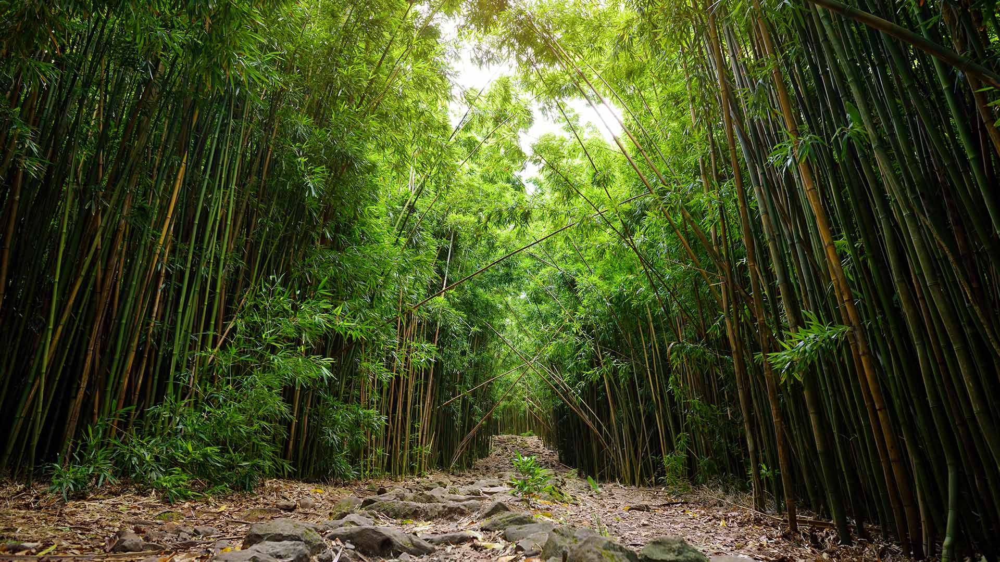
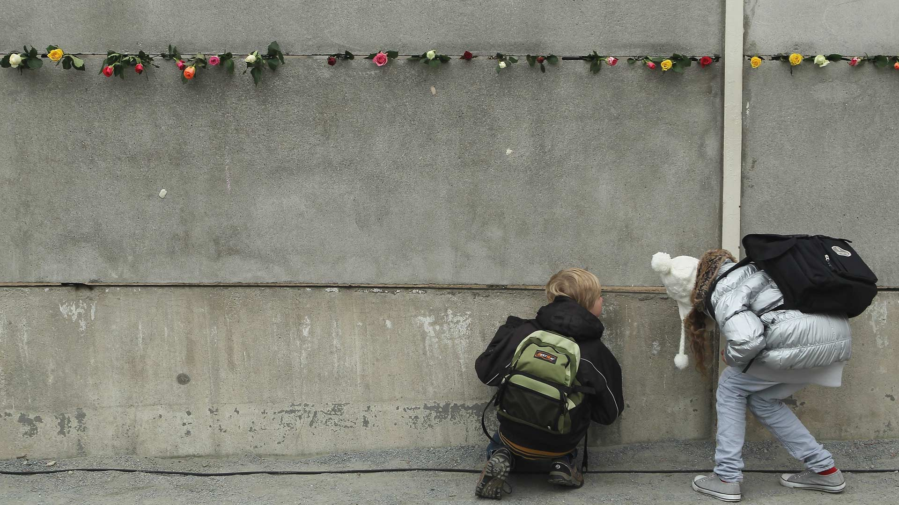

|fullstartdate|name|copyright|title|image|
|--|--|--|--|--|
202610312300|SchwarzwaldAutumn|Schwarzwald, Baden-Württemberg (© Britus/Getty Images)|Wälder im Nebel||
202611012300|HudsonBear|Eisbär mit Jungen, Hudson Bay, Manitoba, Kanada (© Danita Delimont/Adobe Stock)|Eine Zukunft, geprägt vom Eis||
202611022300|AlpineBraies|Pragser Wildsee, Naturpark Fanes‑Sennes‑Prags, Dolomiten, Italien (© leonid_tit/Getty Images)|Stille Gipfelwelten||
202611032300|AutumnChina|Paddler zwischen farbenprächtigen Sumpfzypressen, Xuancheng, Anhui, China (© Jackal Pan/Getty Images)|Paddeln durch ein Gemälde||
202611042300|StileCrossing|Holzsteg an einer Steinmauer, Black Crag, Lake District, England (© Alex Treadway/Getty Images)|Ein Schritt näher am Gipfel||
202611052300|PipiwaiTrail|Bambuswald, Pīpīwai Trail, Haleakalā-Nationalpark, Maui, Hawaii, USA (© MNStudio/Getty Images)|Ein grüner Tunnel durch Maui||
202611062300|DakotaBison|Ein Bison in der Grassteppe des Theodore-Roosevelt-Nationalparks, Nord-Dakota, USA (© Tandem Stock/Adobe Stock)|Der zurückgekehrte Riese||
202611072300|DiwaliLamps|Laternen für Diwali, Mumbai, Maharashtra, Indien (© Dinodia Photo/Getty Images)|Ein strahlendes Fest||
202611082300|MauerBerlin|Schüler spähen durch einen Spalt in einem noch erhaltenen Abschnitt der Berliner Mauer (© Sean Gallup/Getty Images)|Die Nacht, die Deutschland veränderte||
202611092300|RoseIsland|Luftaufnahme von Rose Island, Bahamas (© Abstract Aerial Art/Getty Images)|Die Lizenz zum Chillen||
202611102300|Atlantica|Der Atlantische Regenwald, Brasilien (© FG Trade/Getty Images)|Ein Wald voller Wunder||
202611112300|NorthWindow|North Window, Arches-Nationalpark, Moab, Utah, USA (© lightphoto/Getty Images)|Architektur ohne Architekten||
202611122300|AbrahamCanada|Abraham Lake in Alberta, Kanada (© Guang Cao/Getty Images)|Verborgene Tiefen||
202611132300|BlueHK|Victoria Harbour, Hongkong, China (© Juan Romero/Cavan Images)|Hoch, höher, Hongkong||
202611142300|FirstFrost|Gefrorene Azalee mit roten Blättern (© avoferten/Shutterstock)|Frostige Blätter||
202611152300|GilaCliff|Gila Cliff Dwellings National Monument, New Mexico, USA (© Chiara Salvadori/Getty Images)|Für die Ewigkeit gebaut||
202611162300|TrailCedars|Trail of the Cedars, Glacier-Nationalpark, Montana, USA (© DBushue Photography/Getty Images)|Raus in die Natur!||
202611172300|BarnOwlsUnite|Ein Schleiereulenpaar (© Zahoor Salmi/Getty Images)|Jäger der Nacht||
202611182300|KnowledgeSculpture|Die Skulptur „Body of Knowledge“ von Jaume Plensa an der Goethe-Universität in Frankfurt am Main (© Todamo/Shutterstock)|Wo Ideen Gestalt annehmen||
