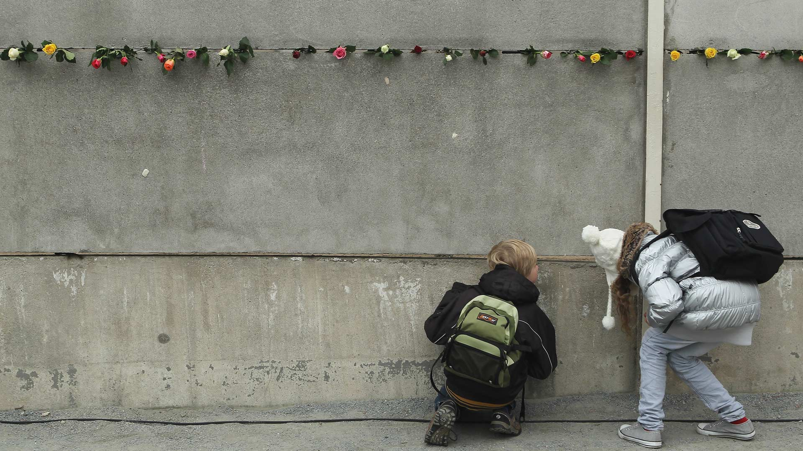

|fullstartdate|name|copyright|title|image|
|--|--|--|--|--|
202610312300|SchwarzwaldAutumn|Schwarzwald, Baden-Württemberg (© Britus/Getty Images)|Wälder im Nebel||
202611012300|HudsonBear|Eisbär mit Jungen, Hudson Bay, Manitoba, Kanada (© Danita Delimont/Adobe Stock)|Eine Zukunft, geprägt vom Eis||
202611022300|AlpineBraies|Pragser Wildsee, Naturpark Fanes‑Sennes‑Prags, Dolomiten, Italien (© leonid_tit/Getty Images)|Stille Gipfelwelten||
202611032300|AutumnChina|Paddler zwischen farbenprächtigen Sumpfzypressen, Xuancheng, Anhui, China (© Jackal Pan/Getty Images)|Paddeln durch ein Gemälde||
202611042300|StileCrossing|Holzsteg an einer Steinmauer, Black Crag, Lake District, England (© Alex Treadway/Getty Images)|Ein Schritt näher am Gipfel||
202611052300|PipiwaiTrail|Bambuswald, Pīpīwai Trail, Haleakalā-Nationalpark, Maui, Hawaii, USA (© MNStudio/Getty Images)|Ein grüner Tunnel durch Maui||
202611062300|DakotaBison|Ein Bison in der Grassteppe des Theodore-Roosevelt-Nationalparks, Nord-Dakota, USA (© Tandem Stock/Adobe Stock)|Der zurückgekehrte Riese||
202611072300|DiwaliLamps|Laternen für Diwali, Mumbai, Maharashtra, Indien (© Dinodia Photo/Getty Images)|Ein strahlendes Fest||
202611082300|MauerBerlin|Schüler spähen durch einen Spalt in einem noch erhaltenen Abschnitt der Berliner Mauer (© Sean Gallup/Getty Images)|Die Nacht, die Deutschland veränderte||
