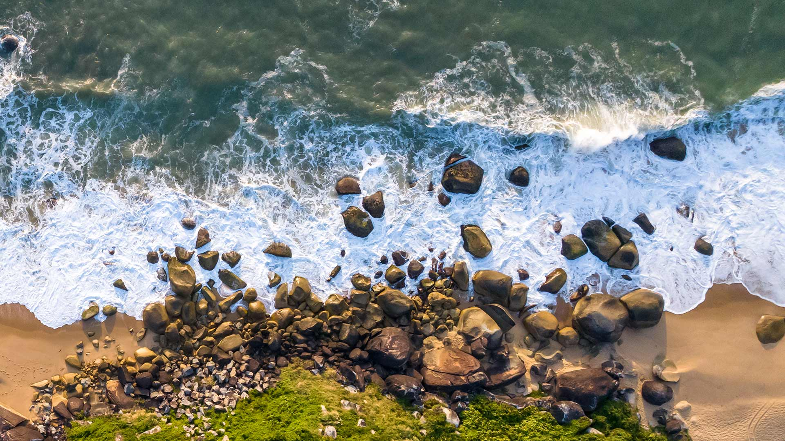
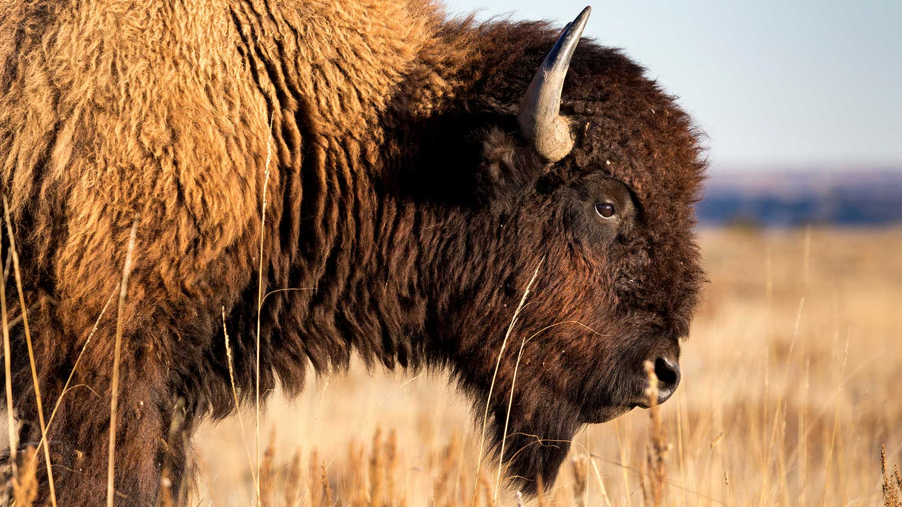
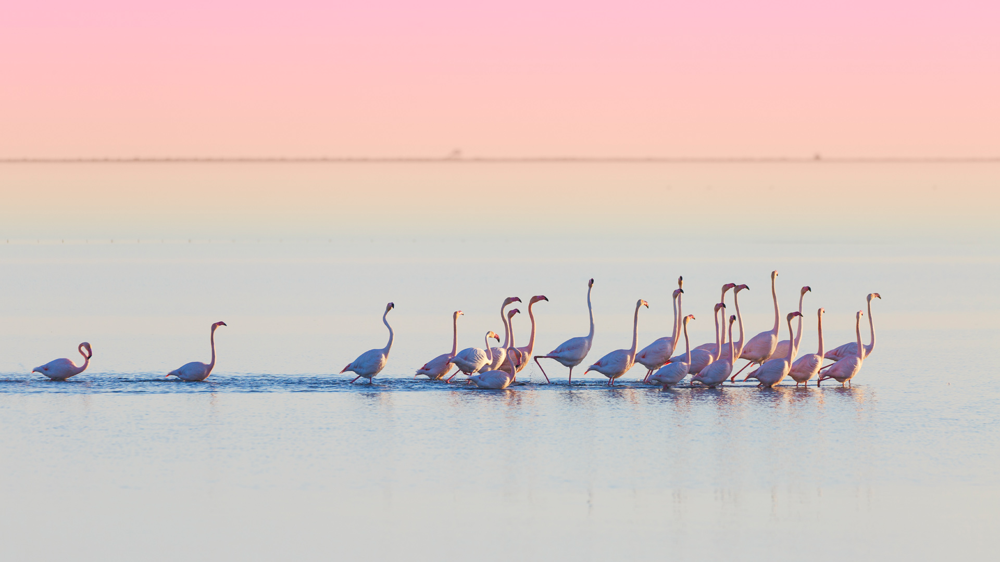

|fullstartdate|name|copyright|title|image|
|--|--|--|--|--|
202610310700|AlpineBraies|Lake Braies, Fanes‑Sennes‑Braies Nature Park, Dolomites, Italy (© leonid_tit/Getty Images)|Info||
202611010700|SchwarzwaldAutumn|Black Forest, Baden-Württemberg, Germany (© Britus/Getty Images)|Info||
202611020800|HudsonBear|Polar bear and cubs by Hudson Bay, Manitoba, Canada (© Danita Delimont/Adobe Stock)|Info||
202611030800|Camburiu|Taquaras Beach, Balneário Camboriú, Brazil (© MaRabelo/Getty Images)|Info||
202611040800|AutumnChina|People rowing among colourful bald cypress, Xuancheng, Anhui, China (© Jackal Pan/Getty Images)|Info||
202611050800|StileCrossing|Wooden stile at a stone wall, Black Crag, Lake District, England (© Alex Treadway/Getty Images)|Info||
202611060800|PipiwaiTrail|Bamboo forest, Pīpīwai Trail, Haleakalā National Park, Maui, Hawaii, USA (© MNStudio/Getty Images)|Info||
202611070800|DakotaBison|A bison in the grasslands of Theodore Roosevelt National Park, North Dakota, USA (© Tandem Stock/Adobe Stock)|Info||
202611080800|DeltaEbro|Flamingos in Ebro Delta Natural Park, Catalonia, Spain (© mafrmcfa/Getty Images)|Info||
202611090800|TrianaSpain|Historic district of Triana, Seville, Spain (© Andrzej Rostek/Getty Images)|Info||
