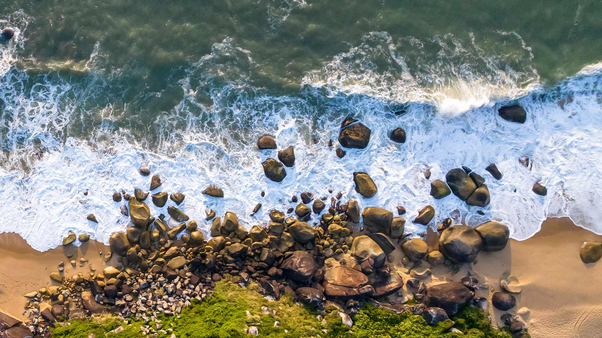
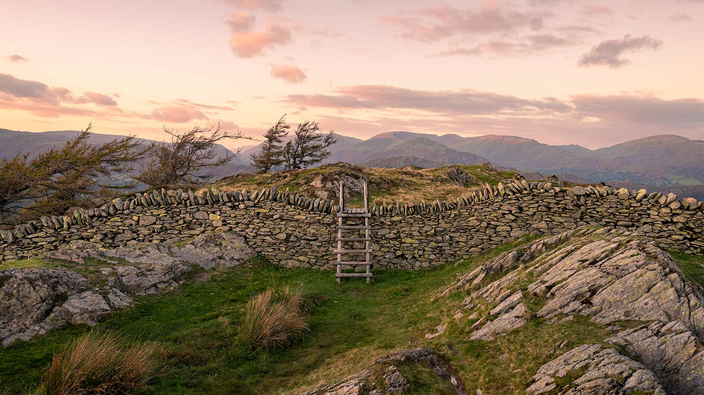
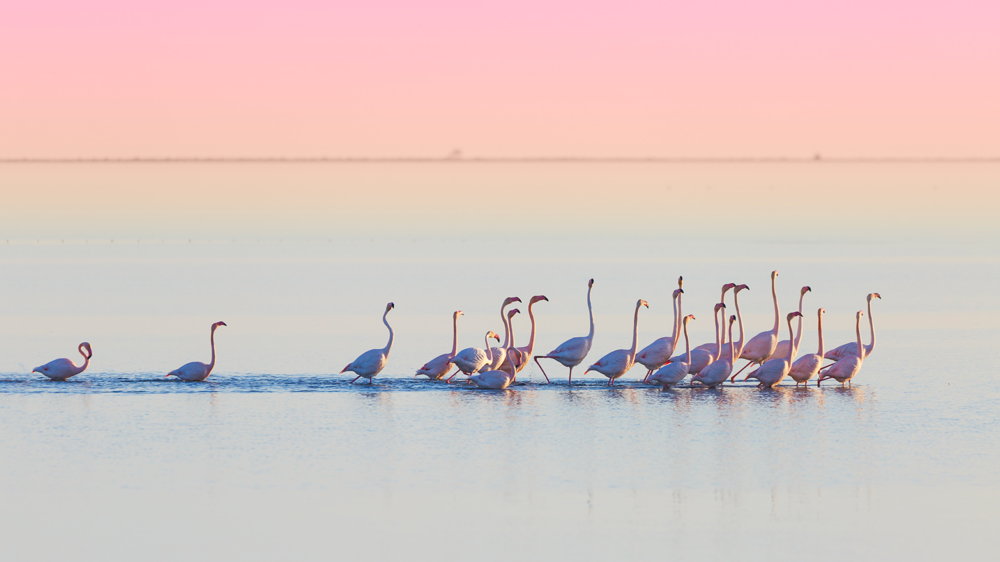
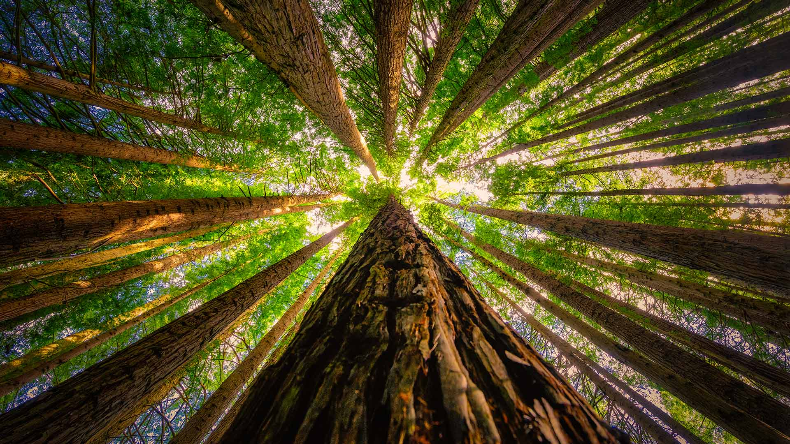
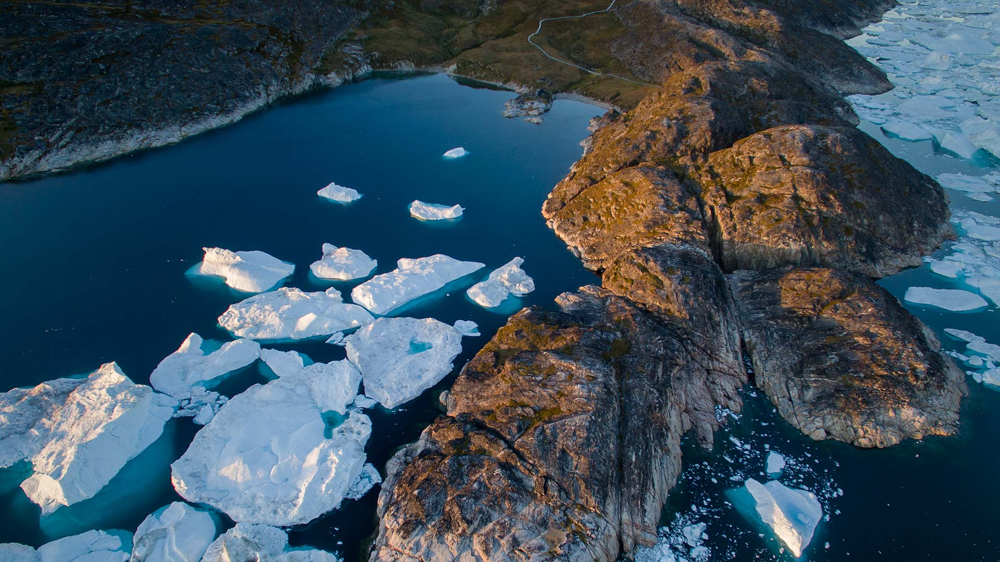

|fullstartdate|name|copyright|title|image|
|--|--|--|--|--|
202610310700|AlpineBraies|Lake Braies, Fanes‑Sennes‑Braies Nature Park, Dolomites, Italy (© leonid_tit/Getty Images)|Info||
202611010700|SchwarzwaldAutumn|Black Forest, Baden-Württemberg, Germany (© Britus/Getty Images)|Info||
202611020800|HudsonBear|Polar bear and cubs by Hudson Bay, Manitoba, Canada (© Danita Delimont/Adobe Stock)|Info||
202611030800|Camburiu|Taquaras Beach, Balneário Camboriú, Brazil (© MaRabelo/Getty Images)|Info||
202611040800|AutumnChina|People rowing among colourful bald cypress, Xuancheng, Anhui, China (© Jackal Pan/Getty Images)|Info||
202611050800|StileCrossing|Wooden stile at a stone wall, Black Crag, Lake District, England (© Alex Treadway/Getty Images)|Info||
202611060800|PipiwaiTrail|Bamboo forest, Pīpīwai Trail, Haleakalā National Park, Maui, Hawaii, USA (© MNStudio/Getty Images)|Info||
202611070800|DakotaBison|A bison in the grasslands of Theodore Roosevelt National Park, North Dakota, USA (© Tandem Stock/Adobe Stock)|Info||
202611080800|DeltaEbro|Flamingos in Ebro Delta Natural Park, Catalonia, Spain (© mafrmcfa/Getty Images)|Info||
202611090800|TrianaSpain|Historic district of Triana, Seville, Spain (© Andrzej Rostek/Getty Images)|Info||
202611100800|RoseIsland|Aerial view of Rose Island, The Bahamas (© Abstract Aerial Art/Getty Images)|Info||
202611110800|Atlantica|The Atlantic Forest, Brazil (© FG Trade/Getty Images)|Info||
202611120800|NorthWindow|North Window, Arches National Park, Moab, Utah, USA (© lightphoto/Getty Images)|Info||
202611130800|AbrahamCanada|Abraham Lake in Alberta, Canada (© Guang Cao/Getty Images)|Info||
202611140800|BlueHK|Victoria Harbour, Hong Kong, China (© Juan Romero/Cavan Images)|Info||
202611150800|FirstFrost|Frozen azalea with red leaves (© avoferten/Shutterstock)|Info||
202611160800|GilaCliff|Gila Cliff Dwellings National Monument, New Mexico, USA (© Chiara Salvadori/Getty Images)|Info||
202611170800|TrailCedars|Trail of the Cedars, Glacier National Park, Montana, USA (© DBushue Photography/Getty Images)|Info||
202611180800|BarnOwlsUnite|Pair of barn owls (© Zahoor Salmi/Getty Images)|Info||
202611190800|MelbourneRedwoods|Coast redwoods near Melbourne, Victoria, Australia (© James Yu/Getty Images)|Info||
202611200800|Megaptera|Diving humpback whale, Kvaloya, Troms, Northern Norway (© Espen Bergersen/Minden Pictures)|Info||
202611210800|RedNice|Nice, Provence-Alpes-Côte d'Azur, France (© Siripong Kaewla-iad/Getty Images)|Info||
202611220800|GreenIceberg|Icebergs, Ilulissat, Greenland (© James Yu/Getty Images)|Info||
