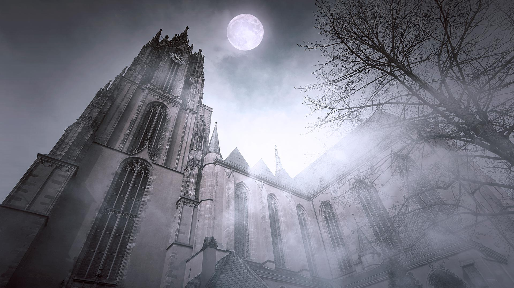

|fullstartdate|name|copyright|title|image|
|--|--|--|--|--|
202610310400|FrankfurtHalloween|St. Bartholomew's Cathedral in Frankfurt, Germany (© AlxeyPnferov/Getty Images)|Ghosts of empires past||
202611010400|SchwarzwaldAutumn|Black Forest, Baden-Württemberg, Germany (© Britus/Getty Images)|Mist among the trees||
202611020500|HudsonBear|Polar bear and cubs by Hudson Bay, Manitoba, Canada (© Danita Delimont/Adobe Stock)|A future written in ice||
202611030500|AlpineBraies|Lake Braies, Fanes‑Sennes‑Braies Nature Park, Dolomites, Italy (© leonid_tit/Getty Images)|Peace among the peaks||
202611040500|AutumnChina|People rowing among colourful bald cypress, Xuancheng, Anhui, China (© Jackal Pan/Getty Images)|Paddling a painted forest||
202611050500|StileCrossing|Wooden stile at a stone wall, Black Crag, Lake District, England (© Alex Treadway/Getty Images)|One step closer to the summit||
