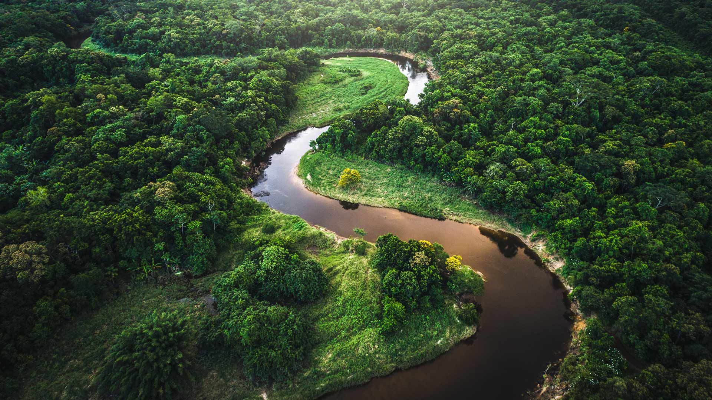
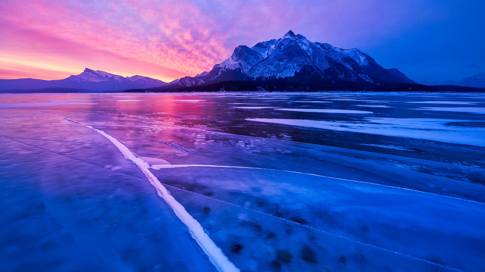
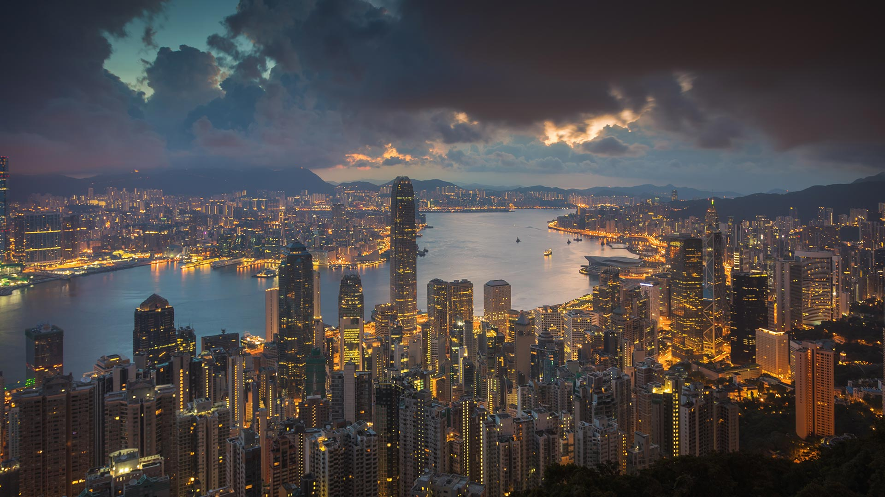

|fullstartdate|name|copyright|title|image|
|--|--|--|--|--|
202610310400|FrankfurtHalloween|St. Bartholomew's Cathedral in Frankfurt, Germany (© AlxeyPnferov/Getty Images)|Ghosts of empires past||
202611010400|SchwarzwaldAutumn|Black Forest, Baden-Württemberg, Germany (© Britus/Getty Images)|Mist among the trees||
202611020500|HudsonBear|Polar bear and cubs by Hudson Bay, Manitoba, Canada (© Danita Delimont/Adobe Stock)|A future written in ice||
202611030500|AlpineBraies|Lake Braies, Fanes‑Sennes‑Braies Nature Park, Dolomites, Italy (© leonid_tit/Getty Images)|Peace among the peaks||
202611040500|AutumnChina|People rowing among colourful bald cypress, Xuancheng, Anhui, China (© Jackal Pan/Getty Images)|Paddling a painted forest||
202611050500|StileCrossing|Wooden stile at a stone wall, Black Crag, Lake District, England (© Alex Treadway/Getty Images)|One step closer to the summit||
202611060500|PipiwaiTrail|Bamboo forest, Pīpīwai Trail, Haleakalā National Park, Maui, Hawaii, USA (© MNStudio/Getty Images)|A green tunnel through Maui||
202611070500|DakotaBison|A bison in the grasslands of Theodore Roosevelt National Park, North Dakota, USA (© Tandem Stock/Adobe Stock)|The giant that came back||
202611080500|DiwaliLamps|Lanterns for Diwali, Mumbai, Maharashtra, India (© Dinodia Photo/Getty Images)|A celebration that shines||
202611090500|TrianaSpain|Historic district of Triana, Seville, Spain (© Andrzej Rostek/Getty Images)|Where art finds its rhythm||
202611100500|RoseIsland|Aerial view of Rose Island, The Bahamas (© Abstract Aerial Art/Getty Images)|Licensed to chill||
202611110500|Atlantica|The Atlantic Forest, Brazil (© FG Trade/Getty Images)|A forest full of wonder||
202611120500|NorthWindow|North Window, Arches National Park, Moab, Utah, USA (© lightphoto/Getty Images)|Architecture without an architect||
202611130500|AbrahamCanada|Abraham Lake in Alberta (© Guang Cao/Getty Images)|Hidden depths||
202611140500|BlueHK|Victoria Harbour, Hong Kong, China (© Juan Romero/Cavan Images)|The only way is up||
