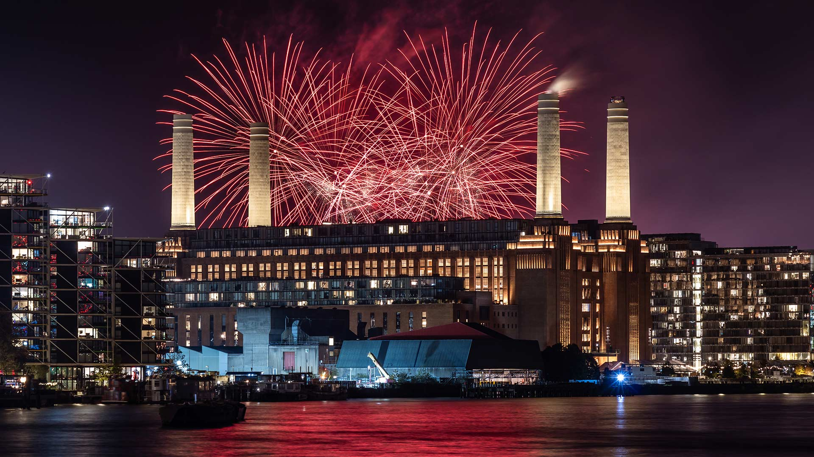

|fullstartdate|name|copyright|title|image|
|--|--|--|--|--|
202611010000|SchwarzwaldAutumn|Black Forest, Baden-Württemberg, Germany (© Britus/Getty Images)|Mist among the trees||
202611020000|HudsonBear|Polar bear and cubs by Hudson Bay, Manitoba, Canada (© Danita Delimont/Adobe Stock)|A future written in ice||
202611030000|AlpineBraies|Lake Braies, Fanes‑Sennes‑Braies Nature Park, Dolomites, Italy (© leonid_tit/Getty Images)|Peace among the peaks||
202611040000|AutumnChina|People rowing among colourful bald cypress, Xuancheng, Anhui, China (© Jackal Pan/Getty Images)|Paddling a painted forest||
202611050000|FireworksBattersea|Fireworks over Battersea Power Station, London (© Michael Lee/Getty Images)|Remember, remember||
202611060000|PipiwaiTrail|Bamboo forest, Pīpīwai Trail, Haleakalā National Park, Maui, Hawaii, USA (© MNStudio/Getty Images)|A green tunnel through Maui||
202611070000|DakotaBison|A bison in the grasslands of Theodore Roosevelt National Park, North Dakota, USA (© Tandem Stock/Adobe Stock)|Roaming the grasslands||
202611080000|DiwaliLamps|Lanterns for Diwali in Mumbai, Maharashtra, India (© Dinodia Photo/Getty Images)|A celebration that shines||
202611090000|TrianaSpain|Historic district of Triana, Seville, Spain (© Andrzej Rostek/Getty Images)|Where art finds its rhythm||
202611100000|RoseIsland|Aerial view of Rose Island, The Bahamas (© Abstract Aerial Art/Getty Images)|Licensed to chill||
