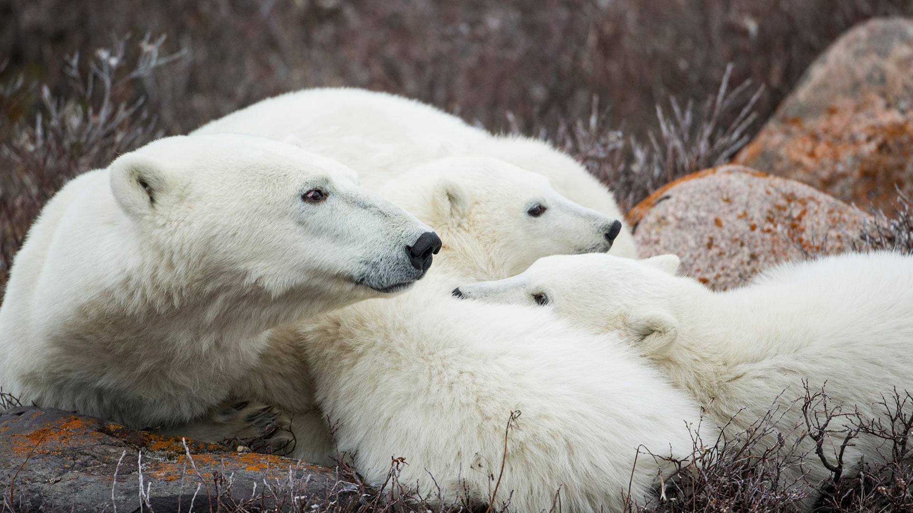
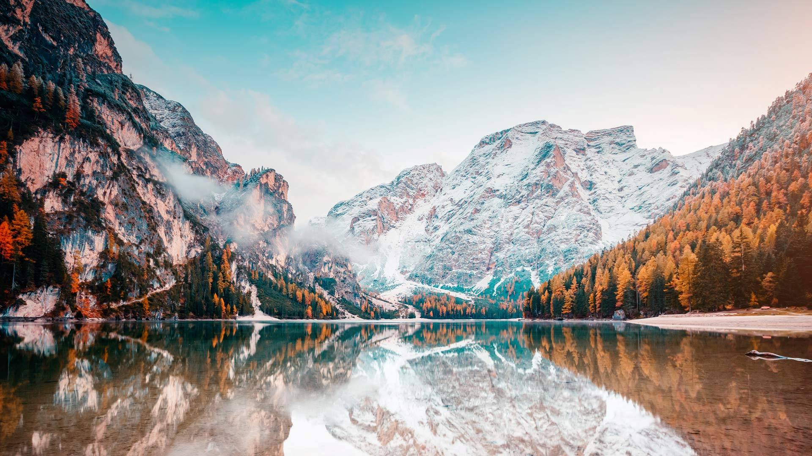
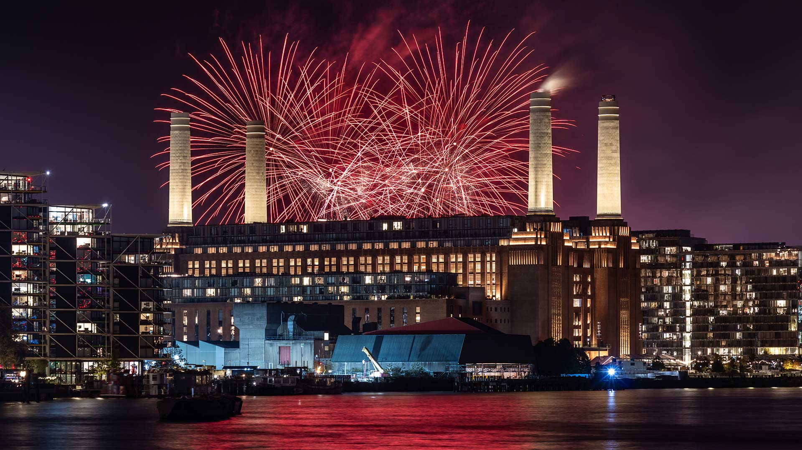
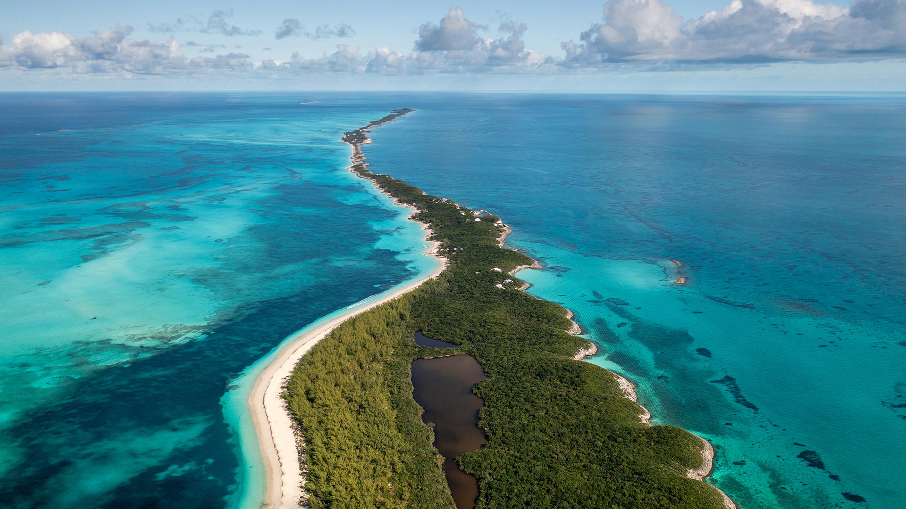
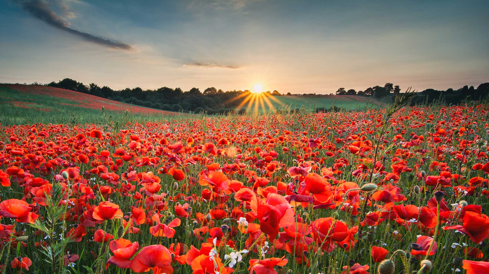
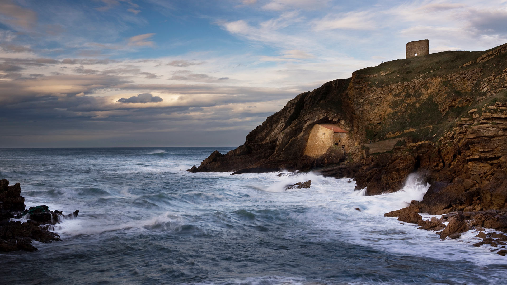

|fullstartdate|name|copyright|title|image|
|--|--|--|--|--|
202611010000|SchwarzwaldAutumn|Black Forest, Baden-Württemberg, Germany (© Britus/Getty Images)|Mist among the trees||
202611020000|HudsonBear|Polar bear and cubs by Hudson Bay, Manitoba, Canada (© Danita Delimont/Adobe Stock)|A future written in ice||
202611030000|AlpineBraies|Lake Braies, Fanes‑Sennes‑Braies Nature Park, Dolomites, Italy (© leonid_tit/Getty Images)|Peace among the peaks||
202611040000|AutumnChina|People rowing among colourful bald cypress, Xuancheng, Anhui, China (© Jackal Pan/Getty Images)|Paddling a painted forest||
202611050000|FireworksBattersea|Fireworks over Battersea Power Station, London (© Michael Lee/Getty Images)|Remember, remember||
202611060000|PipiwaiTrail|Bamboo forest, Pīpīwai Trail, Haleakalā National Park, Maui, Hawaii, USA (© MNStudio/Getty Images)|A green tunnel through Maui||
202611070000|DakotaBison|A bison in the grasslands of Theodore Roosevelt National Park, North Dakota, USA (© Tandem Stock/Adobe Stock)|Roaming the grasslands||
202611080000|DiwaliLamps|Lanterns for Diwali in Mumbai, Maharashtra, India (© Dinodia Photo/Getty Images)|A celebration that shines||
202611090000|TrianaSpain|Historic district of Triana, Seville, Spain (© Andrzej Rostek/Getty Images)|Where art finds its rhythm||
202611100000|RoseIsland|Aerial view of Rose Island, The Bahamas (© Abstract Aerial Art/Getty Images)|Licensed to chill||
202611110000|PoppiesField|A field of poppies (© lloyd-horgan/Getty Images)|We will remember them||
202611120000|NorthWindow|North Window, Arches National Park, Moab, Utah, USA (© lightphoto/Getty Images)|Architecture without an architect||
202611130000|AbrahamCanada|Abraham Lake in Alberta, Canada (© Guang Cao/Getty Images)|Hidden depths||
202611140000|BlueHK|Victoria Harbour, Hong Kong, China (© Juan Romero/Cavan Images)|The only way is up||
202611150000|FirstFrost|Frozen azalea with red leaves (© avoferten/Shutterstock)|Frosty foliage||
202611160000|GilaCliff|Gila Cliff Dwellings National Monument, New Mexico, USA (© Chiara Salvadori/Getty Images)|Built to last||
202611170000|TrailCedars|Trail of the Cedars, Glacier National Park, Montana, USA (© DBushue Photography/Getty Images)|Step into the great outdoors||
202611180000|BarnOwlsUnite|Pair of barn owls (© Zahoor Salmi/Getty Images)|Hunting from dusk till dawn||
202611190000|KnowledgeSculpture|The "Body of Knowledge" sculpture by Jaume Plensa at Goethe University in Frankfurt, Germany (© Todamo/Shutterstock)|Where ideas take shape||
202611200000|Megaptera|Diving humpback whale, Kvaloya, Troms, Northern Norway (© Espen Bergersen/Minden Pictures)|Feasting in the fjords||
202611210000|RedNice|Nice, Provence-Alpes-Côte d'Azur, France (© Siripong Kaewla-iad/Getty Images)|Terracotta dreams||
202611220000|JustaHermitage|The chapel and hermitage of Santa Justa in Cantabria, Spain (© Tramont_ana/Getty Images)|Shelter among the waves||
202611230000|FibonacciFern|Fiddlehead fern (© Reza Saputra/Getty Images)|Geometry in nature||
