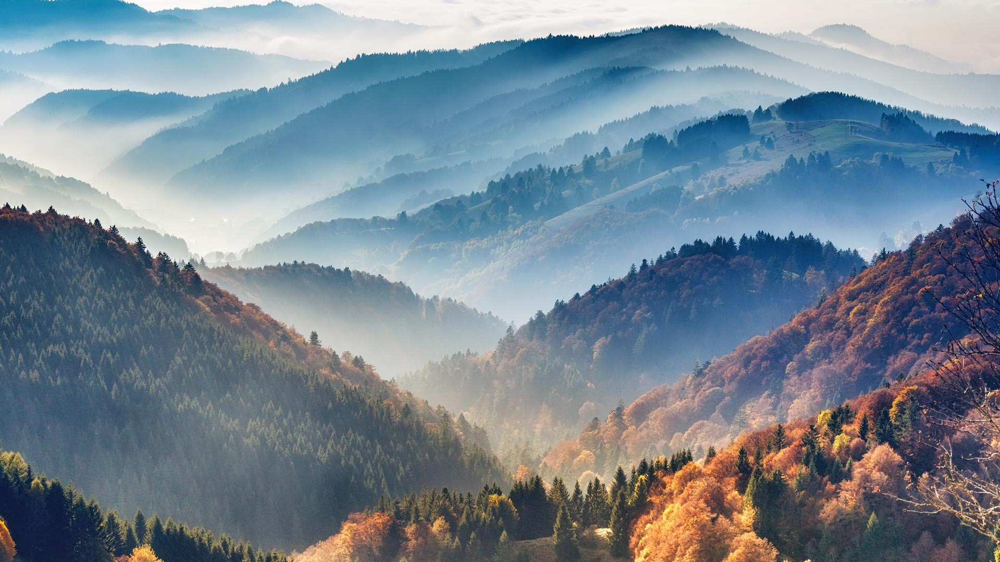
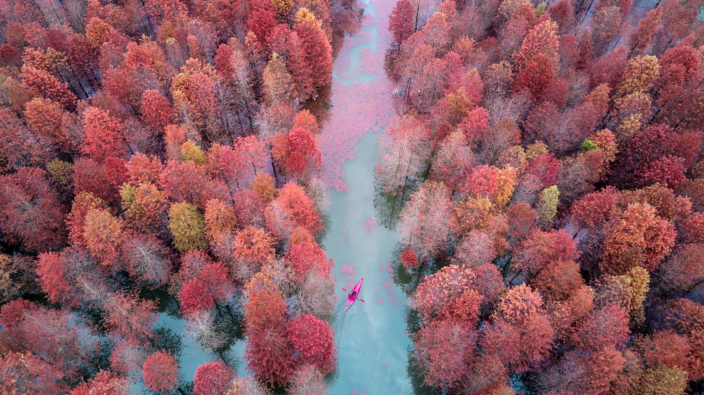
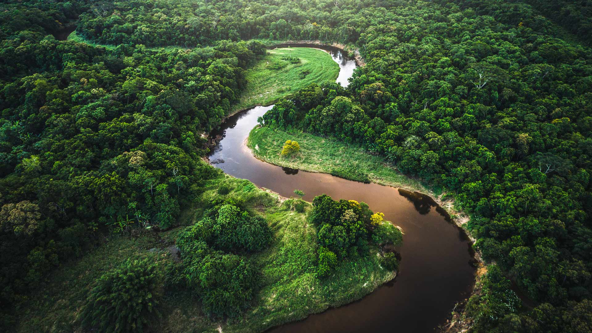
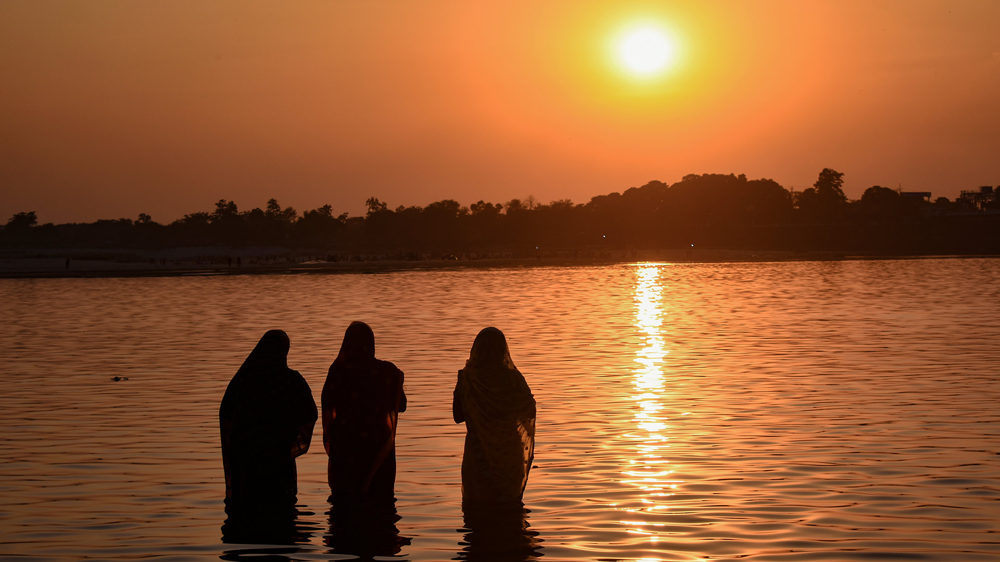
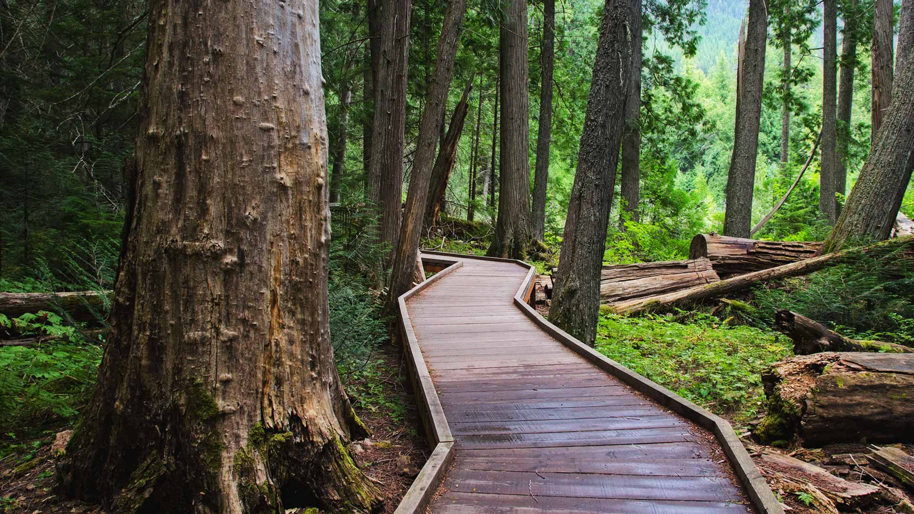
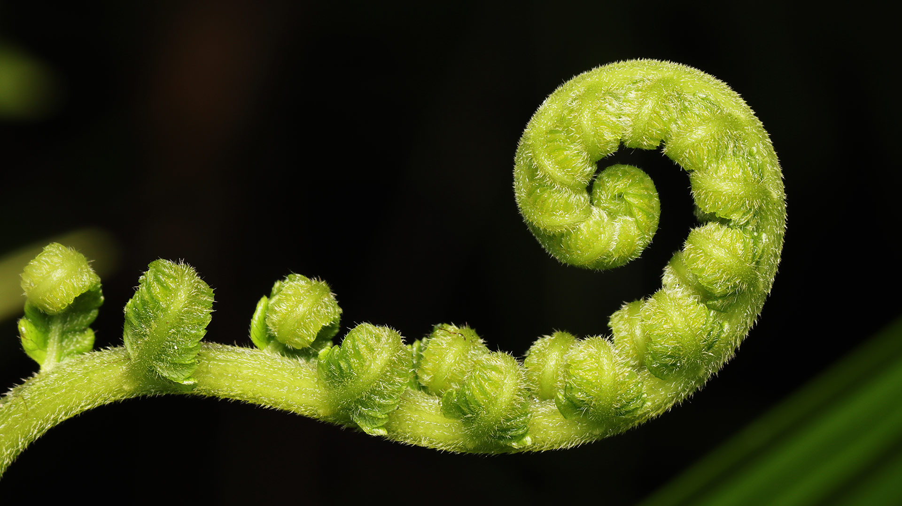

|fullstartdate|name|copyright|title|image|
|--|--|--|--|--|
202610311830|SchwarzwaldAutumn|Black Forest, Baden-Württemberg, Germany (© Britus/Getty Images)|Mist among the trees||
202611011830|HudsonBear|Polar bear and cubs by Hudson Bay, Manitoba, Canada (© Danita Delimont/Adobe Stock)|A future written in ice||
202611021830|AlpineBraies|Lake Braies, Fanes‑Sennes‑Braies Nature Park, Dolomites, Italy (© leonid_tit/Getty Images)|Peace among the peaks||
202611031830|AutumnChina|People rowing among colourful bald cypress, Xuancheng, Anhui, China (© Jackal Pan/Getty Images)|Paddling a painted forest||
202611041830|StileCrossing|Wooden stile at a stone wall, Black Crag, Lake District, England (© Alex Treadway/Getty Images)|One step closer to the summit||
202611051830|PipiwaiTrail|Bamboo forest, Pīpīwai Trail, Haleakalā National Park, Maui, Hawaii, USA (© MNStudio/Getty Images)|A green tunnel through Maui||
202611061830|DakotaBison|A bison in the grasslands of Theodore Roosevelt National Park, North Dakota, USA (© Tandem Stock/Adobe Stock)|Roaming the grasslands||
202611071830|DiwaliLamps|Lanterns for Diwali in Mumbai, Maharashtra (© Dinodia Photo/Getty Images)|Happy Diwali!||
202611081830|TrianaSpain|Historic district of Triana, Seville, Spain (© Andrzej Rostek/Getty Images)|Where art finds its rhythm||
202611091830|RoseIsland|Aerial view of Rose Island, The Bahamas (© Abstract Aerial Art/Getty Images)|Licensed to chill||
202611101830|Atlantica|The Atlantic Forest, Brazil (© FG Trade/Getty Images)|A forest full of wonder||
202611111830|NorthWindow|North Window, Arches National Park, Moab, Utah, USA (© lightphoto/Getty Images)|Architecture without an architect||
202611121830|ChhathPuja2026|Sunset over the Damodar River during Chhath Puja (© ParthapratimMukherjee2056/Shutterstock)|Glow of Chhath Puja||
202611131830|BlueHK|Victoria Harbour, Hong Kong, China (© Juan Romero/Cavan Images)|The only way is up||
202611141830|FirstFrost|Frozen azalea with red leaves (© avoferten/Shutterstock)|Frosty foliage||
202611151830|GilaCliff|Gila Cliff Dwellings National Monument, New Mexico, USA (© Chiara Salvadori/Getty Images)|Built to last||
202611161830|TrailCedars|Trail of the Cedars, Glacier National Park, Montana, USA (© DBushue Photography/Getty Images)|Step into the great outdoors||
202611171830|BarnOwlsUnite|Pair of barn owls (© Zahoor Salmi/Getty Images)|Hunting from dusk till dawn||
202611181830|KnowledgeSculpture|The "Body of Knowledge" sculpture by Jaume Plensa at Goethe University in Frankfurt, Germany (© Todamo/Shutterstock)|Where ideas take shape||
202611191830|Megaptera|Diving humpback whale, Kvaløya, Troms, Northern Norway (© Espen Bergersen/Minden Pictures)|Feasting in the fjords||
202611201830|RedNice|Nice, Provence-Alpes-Côte d'Azur, France (© Siripong Kaewla-iad/Getty Images)|Terracotta dreams||
202611211830|JustaHermitage|The chapel and hermitage of Santa Justa in Cantabria, Spain (© Tramont_ana/Getty Images)|Shelter among the waves||
202611221830|FibonacciFern|Fiddlehead fern (© Reza Saputra/Getty Images)|Geometry in nature||
