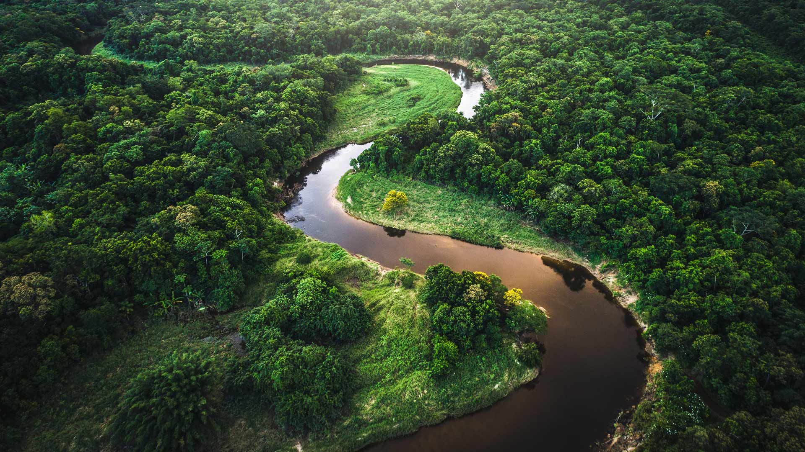
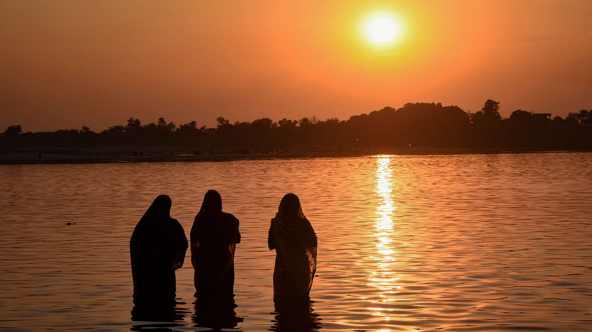
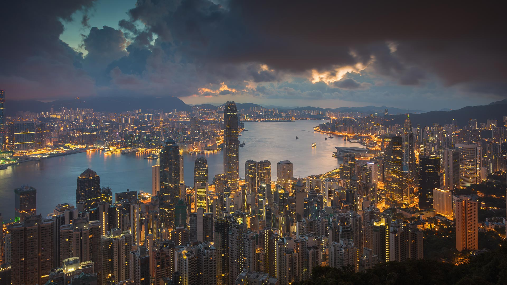

|fullstartdate|name|copyright|title|image|
|--|--|--|--|--|
202610311830|SchwarzwaldAutumn|Black Forest, Baden-Württemberg, Germany (© Britus/Getty Images)|Mist among the trees||
202611011830|HudsonBear|Polar bear and cubs by Hudson Bay, Manitoba, Canada (© Danita Delimont/Adobe Stock)|A future written in ice||
202611021830|AlpineBraies|Lake Braies, Fanes‑Sennes‑Braies Nature Park, Dolomites, Italy (© leonid_tit/Getty Images)|Peace among the peaks||
202611031830|AutumnChina|People rowing among colourful bald cypress, Xuancheng, Anhui, China (© Jackal Pan/Getty Images)|Paddling a painted forest||
202611041830|StileCrossing|Wooden stile at a stone wall, Black Crag, Lake District, England (© Alex Treadway/Getty Images)|One step closer to the summit||
202611051830|PipiwaiTrail|Bamboo forest, Pīpīwai Trail, Haleakalā National Park, Maui, Hawaii, USA (© MNStudio/Getty Images)|A green tunnel through Maui||
202611061830|DakotaBison|A bison in the grasslands of Theodore Roosevelt National Park, North Dakota, USA (© Tandem Stock/Adobe Stock)|Roaming the grasslands||
202611071830|DiwaliLamps|Lanterns for Diwali in Mumbai, Maharashtra (© Dinodia Photo/Getty Images)|Happy Diwali!||
202611081830|TrianaSpain|Historic district of Triana, Seville, Spain (© Andrzej Rostek/Getty Images)|Where art finds its rhythm||
202611091830|RoseIsland|Aerial view of Rose Island, The Bahamas (© Abstract Aerial Art/Getty Images)|Licensed to chill||
202611101830|Atlantica|The Atlantic Forest, Brazil (© FG Trade/Getty Images)|A forest full of wonder||
202611111830|NorthWindow|North Window, Arches National Park, Moab, Utah, USA (© lightphoto/Getty Images)|Architecture without an architect||
202611121830|ChhathPuja2026|Sunset over the Damodar River during Chhath Puja (© ParthapratimMukherjee2056/Shutterstock)|Glow of Chhath Puja||
202611131830|BlueHK|Victoria Harbour, Hong Kong, China (© Juan Romero/Cavan Images)|The only way is up||
