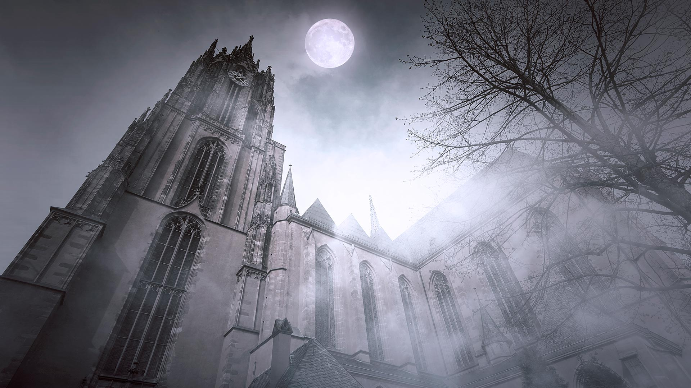
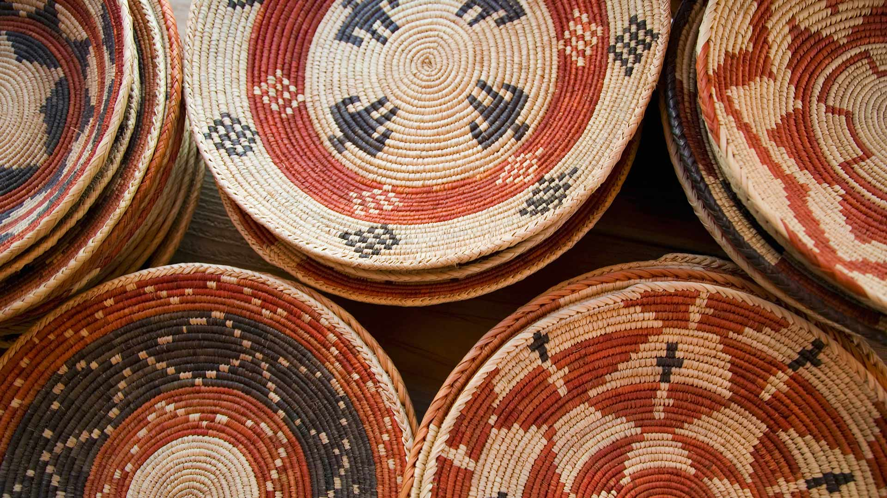
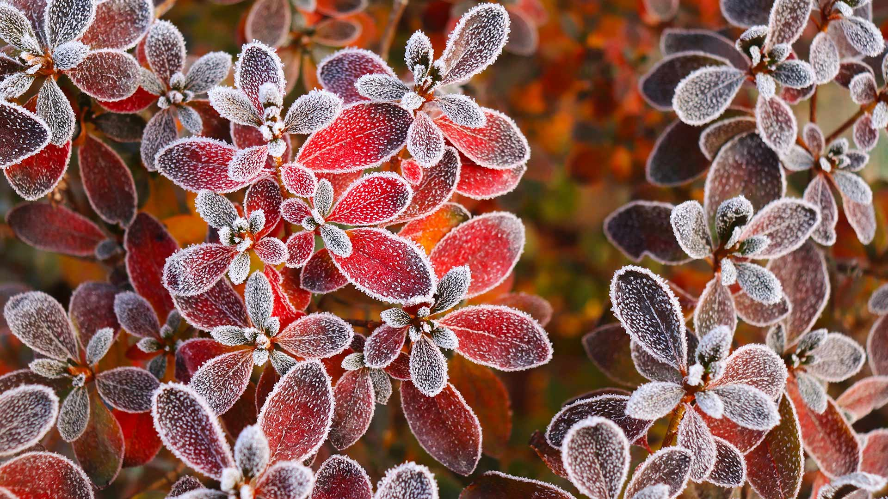
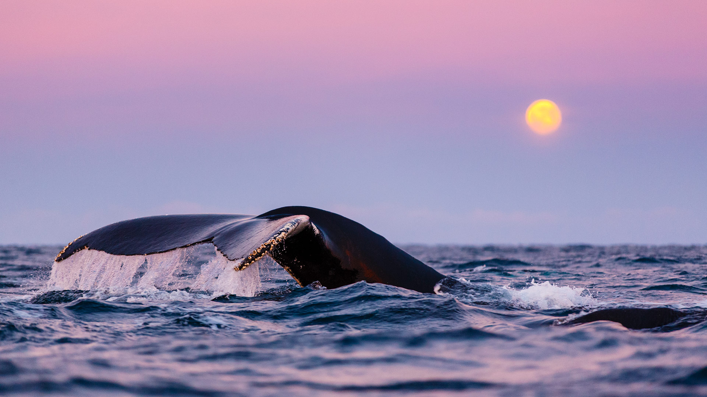
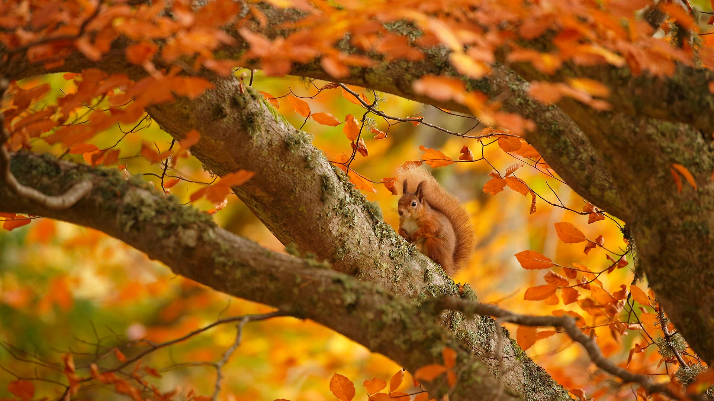

|fullstartdate|name|copyright|title|image|
|--|--|--|--|--|
202610310700|FrankfurtHalloween|St. Bartholomew's Cathedral in Frankfurt, Germany (© AlxeyPnferov/Getty Images)|Ghosts of empires past||
202611010700|NativeBaskets|Handmade baskets, Santa Fe, New Mexico (© Patrick Lane/Getty Images)|Crafting continuity||
202611020800|HudsonBear|Polar bear and cubs by Hudson Bay, Manitoba, Canada (© Danita Delimont/Adobe Stock)|A future written in ice||
202611030800|AlpineBraies|Lake Braies, Fanes‑Sennes‑Braies Nature Park, Dolomites, Italy (© leonid_tit/Getty Images)|Peace among the peaks||
202611040800|AutumnChina|People rowing among colorful bald cypress, Xuancheng, Anhui, China (© Jackal Pan/Getty Images)|Paddling a painted forest||
202611050800|StileCrossing|Wooden stile at a stone wall, Black Crag, Lake District, England (© Alex Treadway/Getty Images)|One step closer to the summit||
202611060800|PipiwaiTrail|Bamboo forest, Pīpīwai Trail, Haleakalā National Park, Maui, Hawaii (© MNStudio/Getty Images)|A green tunnel through Maui||
202611070800|DakotaBison|A bison in the grasslands of Theodore Roosevelt National Park, North Dakota (© Tandem Stock/Adobe Stock)|The giant that came back||
202611080800|DiwaliLamps|Lanterns for Diwali, Mumbai, Maharashtra, India (© Dinodia Photo/Getty Images)|A celebration that shines||
202611090800|TrianaSpain|Historic district of Triana, Seville, Spain (© Andrzej Rostek/Getty Images)|Where art finds its rhythm||
202611100800|RoseIsland|Aerial view of Rose Island, The Bahamas (© Abstract Aerial Art/Getty Images)|Licensed to chill||
202611110800|SunsetFlags|American flags in a public park in upstate New York (© Matt Champlin/Getty Images)|A salute in red, white, and blue||
202611120800|NorthWindow|North Window, Arches National Park, Moab, Utah (© lightphoto/Getty Images)|Architecture without an architect||
202611130800|AbrahamCanada|Abraham Lake in Alberta, Canada (© Guang Cao/Getty Images)|Hidden depths||
202611140800|BlueHK|Victoria Harbour, Hong Kong, China (© Juan Romero/Cavan Images)|The only way is up||
202611150800|FirstFrost|Frozen azalea with red leaves (© avoferten/Shutterstock)|Frosty foliage||
202611160800|GilaCliff|Gila Cliff Dwellings National Monument, New Mexico (© Chiara Salvadori/Getty Images)|Built to last||
202611170800|TrailCedars|Trail of the Cedars, Glacier National Park, Montana (© DBushue Photography/Getty Images)|Step into the great outdoors||
202611180800|BarnOwlsUnite|Pair of barn owls (© Zahoor Salmi/Getty Images)|Hunting from dusk till dawn||
202611190800|KnowledgeSculpture|The "Body of Knowledge" sculpture by Jaume Plensa at Goethe University in Frankfurt, Germany (© Todamo/Shutterstock)|Where ideas take shape||
202611200800|Megaptera|Diving humpback whale, Kvaloya, Troms, Northern Norway (© Espen Bergersen/Minden Pictures)|Feasting in the fjords||
202611210800|RedNice|Nice, Provence-Alpes-Côte d'Azur, France (© Siripong Kaewla-iad/Getty Images)|Terracotta dreams||
202611220800|JustaHermitage|The chapel and hermitage of Santa Justa in Cantabria, Spain (© Tramont_ana/Getty Images)|Shelter among the waves||
202611230800|FibonacciFern|Fiddlehead fern (© Reza Saputra/Getty Images)|Geometry in nature||
202611240800|CairngormsSquirrel|Red squirrel in Cairngorms National Park, Highlands, Scotland (© Scotland: The Big Picture/Minden Pictures)|Autumnal camouflage||
