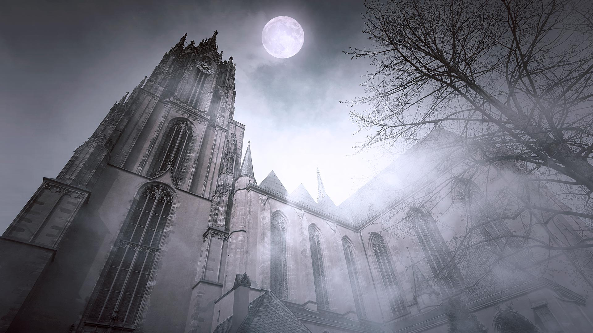
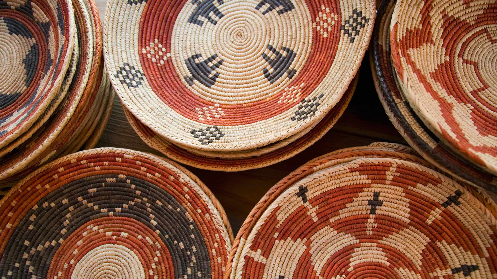
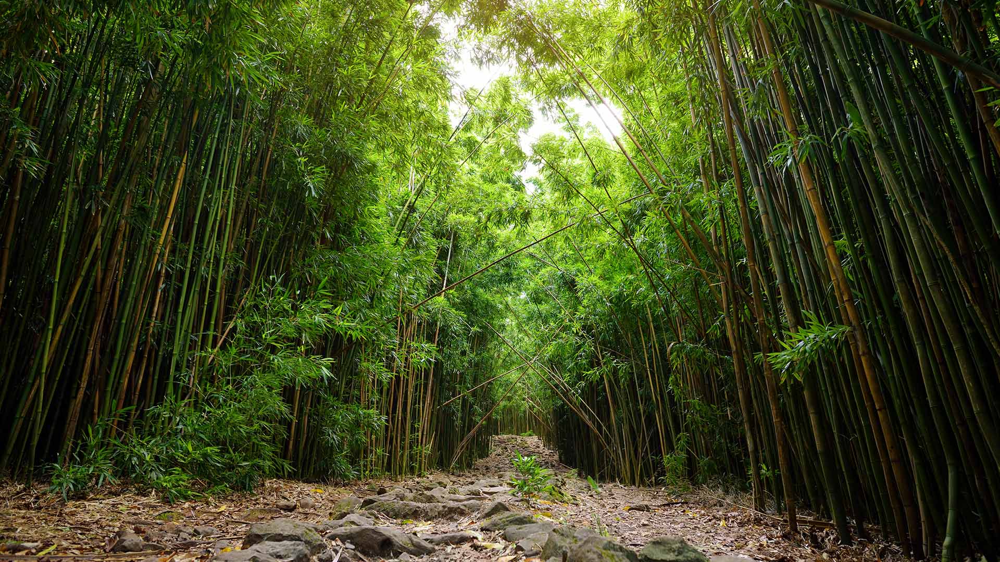
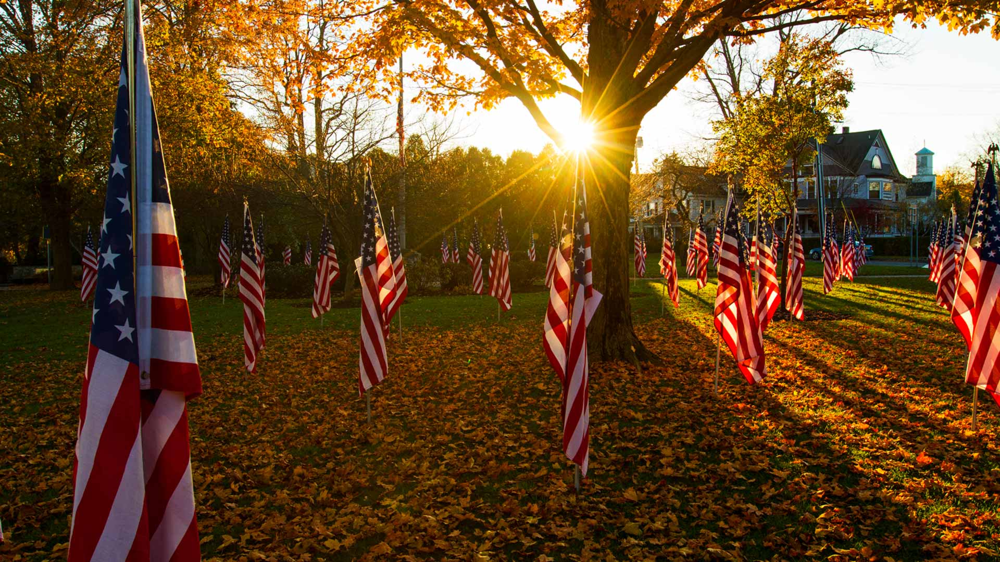

|fullstartdate|name|copyright|title|image|
|--|--|--|--|--|
202610310700|FrankfurtHalloween|St. Bartholomew's Cathedral in Frankfurt, Germany (© AlxeyPnferov/Getty Images)|Ghosts of empires past||
202611010700|NativeBaskets|Handmade baskets, Santa Fe, New Mexico (© Patrick Lane/Getty Images)|Crafting continuity||
202611020800|HudsonBear|Polar bear and cubs by Hudson Bay, Manitoba, Canada (© Danita Delimont/Adobe Stock)|A future written in ice||
202611030800|AlpineBraies|Lake Braies, Fanes‑Sennes‑Braies Nature Park, Dolomites, Italy (© leonid_tit/Getty Images)|Peace among the peaks||
202611040800|AutumnChina|People rowing among colorful bald cypress, Xuancheng, Anhui, China (© Jackal Pan/Getty Images)|Paddling a painted forest||
202611050800|StileCrossing|Wooden stile at a stone wall, Black Crag, Lake District, England (© Alex Treadway/Getty Images)|One step closer to the summit||
202611060800|PipiwaiTrail|Bamboo forest, Pīpīwai Trail, Haleakalā National Park, Maui, Hawaii (© MNStudio/Getty Images)|A green tunnel through Maui||
202611070800|DakotaBison|A bison in the grasslands of Theodore Roosevelt National Park, North Dakota (© Tandem Stock/Adobe Stock)|The giant that came back||
202611080800|DiwaliLamps|Lanterns for Diwali, Mumbai, Maharashtra, India (© Dinodia Photo/Getty Images)|A celebration that shines||
202611090800|TrianaSpain|Historic district of Triana, Seville, Spain (© Andrzej Rostek/Getty Images)|Where art finds its rhythm||
202611100800|RoseIsland|Aerial view of Rose Island, The Bahamas (© Abstract Aerial Art/Getty Images)|Licensed to chill||
202611110800|SunsetFlags|American flags in a public park in upstate New York (© Matt Champlin/Getty Images)|A salute in red, white, and blue||
202611120800|NorthWindow|North Window, Arches National Park, Moab, Utah (© lightphoto/Getty Images)|Architecture without an architect||
