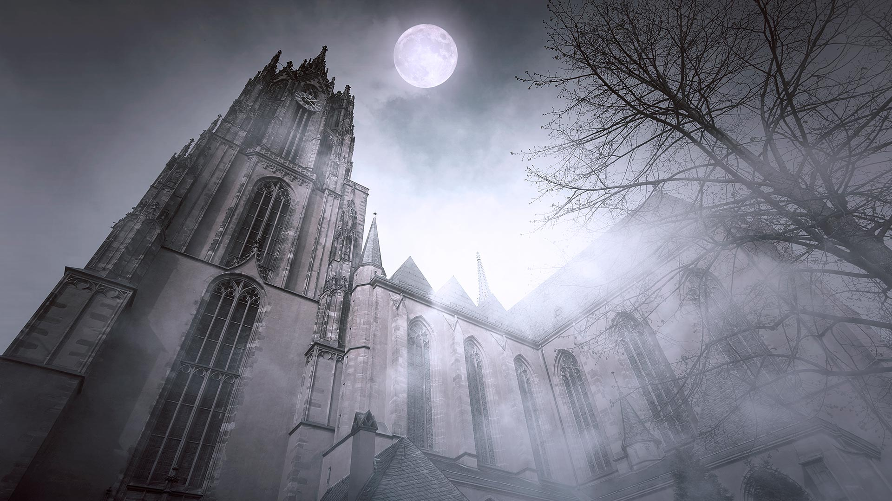
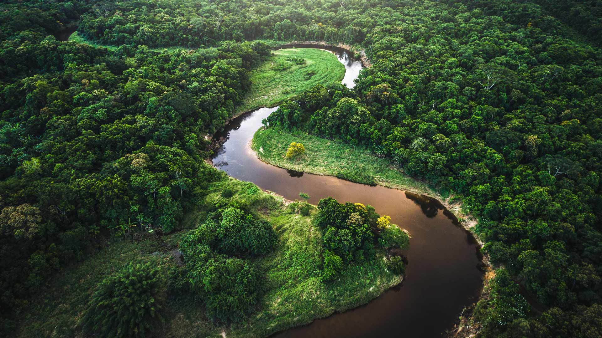

|fullstartdate|name|copyright|title|image|
|--|--|--|--|--|
202610310400|FrankfurtHalloween|Cathédrale Saint-Barthélemy de Francfort, Allemagne (© AlxeyPnferov/Getty Images)|Les fantômes des empires disparus||
202611010400|SchwarzwaldAutumn|Forêt-Noire, Bade-Wurtemberg, Allemagne (© Britus/Getty Images)|Brume entre les arbres||
202611020500|HudsonBear|Ours polaire et ses petits, baie d'Hudson, Manitoba, Canada (© Danita Delimont/Adobe Stock)|Un avenir gravé dans la glace||
202611030500|AlpineBraies|Lac de Braies, parc naturel Fanes-Sennes-Braies, Dolomites, Italie (© leonid_tit/Getty Images)|Sérénité parmi les cimes||
202611040500|AutumnChina|Personnes ramant au milieu de cyprès chauves aux couleurs automnales, Xuancheng, Anhui, Chine (© Jackal Pan/Getty Images)|Pagayer dans une forêt aux mille couleurs||
202611050500|StileCrossing|Échalier en bois dans un muret de pierre, Black Crag, Lake District, Angleterre (© Alex Treadway/Getty Images)|Un pas de plus vers le sommet||
202611060500|PipiwaiTrail|Forêt de bambous, sentier Pīpīwai, parc national de Haleakalā, Maui, Hawaï, États-Unis (© MNStudio/Getty Images)|Un tunnel de verdure à travers Maui||
202611070500|DakotaBison|Bison dans les prairies du parc national Theodore Roosevelt, Dakota du Nord, États-Unis (© Tandem Stock/Adobe Stock)|Le géant qui a fait son retour||
202611080500|DiwaliLamps|Lanternes de Diwali, Mumbai, Maharashtra, Inde (© Dinodia Photo/Getty Images)|Une célébration qui rayonne||
202611090500|TrianaSpain|Quartier historique de Triana, Séville, Espagne (© Andrzej Rostek/Getty Images)|Là où l’art trouve son rythme||
202611100500|RoseIsland|Vue aérienne de Rose Island, aux Bahamas (© Abstract Aerial Art/Getty Images)|Cap sur la détente||
202611110500|Atlantica|Forêt atlantique, Brésil (© FG Trade/Getty Images)|Une forêt pleine de merveilles||
