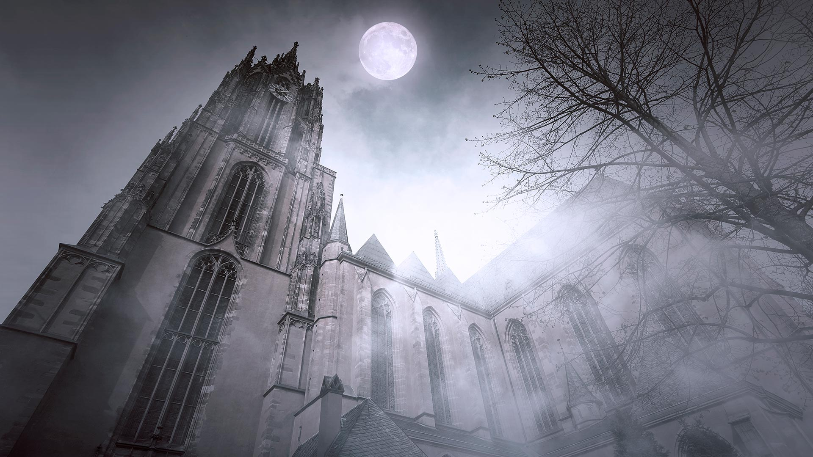

|fullstartdate|name|copyright|title|image|
|--|--|--|--|--|
202610310400|FrankfurtHalloween|Cathédrale Saint-Barthélemy de Francfort, Allemagne (© AlxeyPnferov/Getty Images)|Les fantômes des empires disparus||
202611010400|SchwarzwaldAutumn|Forêt-Noire, Bade-Wurtemberg, Allemagne (© Britus/Getty Images)|Brume entre les arbres||
202611020500|HudsonBear|Ours polaire et ses petits, baie d'Hudson, Manitoba, Canada (© Danita Delimont/Adobe Stock)|Un avenir gravé dans la glace||
202611030500|AlpineBraies|Lac de Braies, parc naturel Fanes-Sennes-Braies, Dolomites, Italie (© leonid_tit/Getty Images)|Sérénité parmi les cimes||
202611040500|AutumnChina|Personnes ramant au milieu de cyprès chauves aux couleurs automnales, Xuancheng, Anhui, Chine (© Jackal Pan/Getty Images)|Pagayer dans une forêt aux mille couleurs||
202611050500|StileCrossing|Échalier en bois dans un muret de pierre, Black Crag, Lake District, Angleterre (© Alex Treadway/Getty Images)|Un pas de plus vers le sommet||
202611060500|PipiwaiTrail|Forêt de bambous, sentier Pīpīwai, parc national de Haleakalā, Maui, Hawaï, États-Unis (© MNStudio/Getty Images)|Un tunnel de verdure à travers Maui||
202611070500|DakotaBison|Bison dans les prairies du parc national Theodore Roosevelt, Dakota du Nord, États-Unis (© Tandem Stock/Adobe Stock)|Le géant qui a fait son retour||
202611080500|DiwaliLamps|Lanternes de Diwali, Mumbai, Maharashtra, Inde (© Dinodia Photo/Getty Images)|Une célébration qui rayonne||
202611090500|TrianaSpain|Quartier historique de Triana, Séville, Espagne (© Andrzej Rostek/Getty Images)|Là où l’art trouve son rythme||
202611100500|RoseIsland|Vue aérienne de Rose Island, aux Bahamas (© Abstract Aerial Art/Getty Images)|Cap sur la détente||
202611110500|Atlantica|Forêt atlantique, Brésil (© FG Trade/Getty Images)|Une forêt pleine de merveilles||
202611120500|NorthWindow|North Window, parc national des Arches, Moab, Utah, États-Unis (© lightphoto/Getty Images)|L’architecte, c’est la nature||
202611130500|AbrahamCanada|Lac Abraham, Alberta, Canada (© Guang Cao/Getty Images)|Profondeurs cachées||
202611140500|BlueHK|Port Victoria, Hong Kong, Chine (© Juan Romero/Cavan Images)|Vers les sommets||
202611150500|FirstFrost|Azalée gelée aux feuilles rouges (© avoferten/Shutterstock)|Feuillage givré||
202611160500|GilaCliff|Monument national des habitations troglodytiques de Gila, Nouveau-Mexique, États-Unis (© Chiara Salvadori/Getty Images)|Construit pour durer||
202611170500|TrailCedars|Sentier des Cèdres, parc national des Glaciers, Montana, États-Unis (© DBushue Photography/Getty Images)|Partez à l'aventure en pleine nature||
202611180500|BarnOwlsUnite|Couple d’effraies des clochers (© Zahoor Salmi/Getty Images)|À la chasse du crépuscule à l’aube||
202611190500|KnowledgeSculpture|La sculpture « Body of Knowledge » de Jaume Plensa à l'université Goethe de Francfort, Allemagne (© Todamo/Shutterstock)|Là où les idées prennent forme||
202611200500|Megaptera|Baleine à bosse (Megaptera novaeangliae) en plongée, Kvaløya, Troms, nord de la Norvège (© Espen Bergersen/Minden Pictures)|Festin dans les fjords||
202611210500|RedNice|Nice, Provence-Alpes-Côte d'Azur, France (© Siripong Kaewla-iad/Getty Images)|Rêves de terre cuite||
202611220500|JustaHermitage|Chapelle et l’ermitage de Santa Justa, Cantabrie, Espagne (© Tramont_ana/Getty Images)|Un refuge parmi les vagues||
