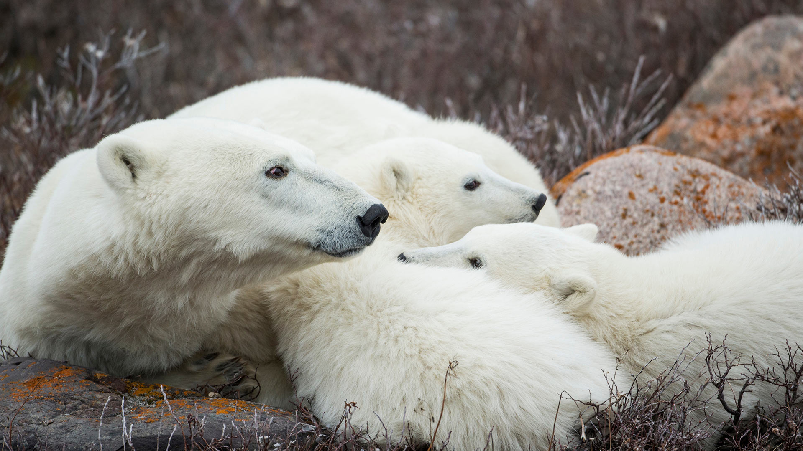

|fullstartdate|name|copyright|title|image|
|--|--|--|--|--|
202610312300|SchwarzwaldAutumn|Forêt-Noire, Bade-Wurtemberg, Allemagne  (© Britus/Getty Images)|Manteau de brume sur la forêt||
202611012300|HudsonBear|Ours polaire et oursons, baie d'Hudson, Manitoba, Canada (© Danita Delimont/Adobe Stock)|Un avenir écrit dans la glace||
202611022300|AlpineBraies|Lac de Braies, Parc naturel Fanes‑Sennes‑Braies, Dolomites, Italie (© leonid_tit/Getty Images)|La paix parmi les sommets||
202611032300|AutumnChina|Kayak dans une forêt de cyprès, Xuancheng, Anhui, Chine (© Jackal Pan/Getty Images)|Glisser à travers une peinture||
202611042300|StileCrossing|Échelle près d'un mur de pierre, Black Crag, Lake District, Angleterre (© Alex Treadway/Getty Images)|Un pas de plus vers le sommet||
202611052300|PipiwaiTrail|Forêt de bambous, Pīpīwai Trail, Hawaii, États-Unis (© MNStudio/Getty Images)|Toit de verdure à travers Maui||
202611062300|DakotaBison|Bison dans le parc national Theodore Roosevelt, Dakota du Nord, États-Unis (© Tandem Stock/Adobe Stock)|Un géant de retour||
202611072300|DiwaliLamps|Lanternes pour Diwali, Mumbai, Maharashtra, Inde (© Dinodia Photo/Getty Images)|Célébration qui scintille||
202611082300|TrianaSpain|Quartier historique de Triana, Séville, Espagne (© Andrzej Rostek/Getty Images)|Ici, l’art trouve son rythme||
202611092300|RoseIsland|Vue aérienne de Rose Island, Bahamas (© Abstract Aerial Art/Getty Images)|Permis de se relaxer||
