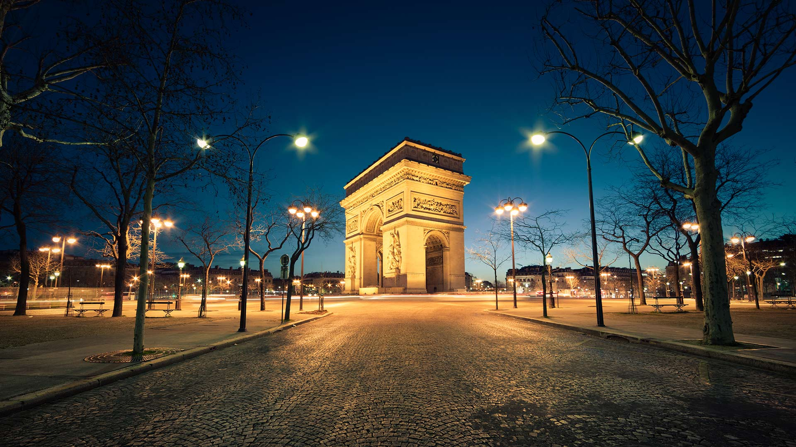
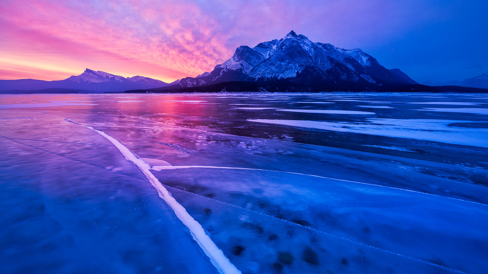
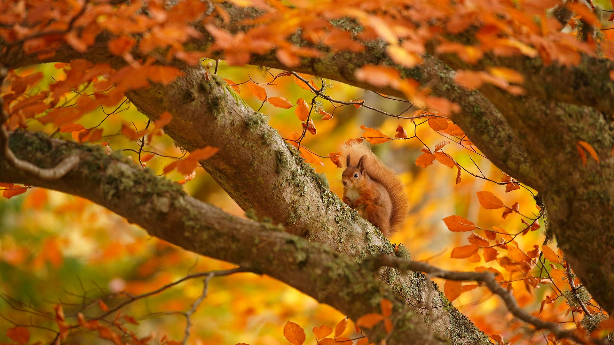
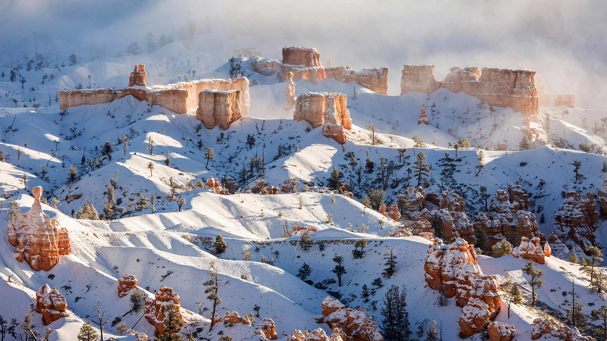
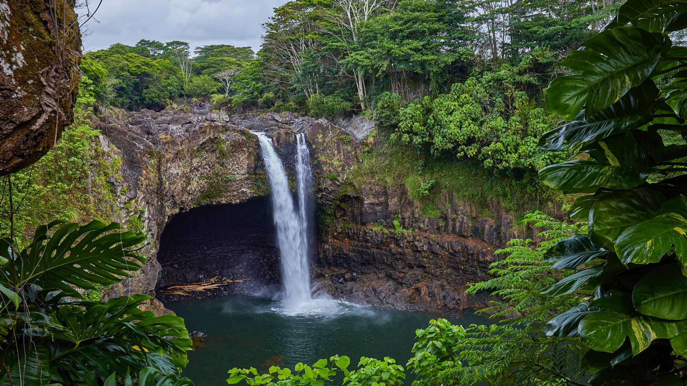

|fullstartdate|name|copyright|title|image|
|--|--|--|--|--|
202610312300|SchwarzwaldAutumn|Forêt-Noire, Bade-Wurtemberg, Allemagne  (© Britus/Getty Images)|Manteau de brume sur la forêt||
202611012300|HudsonBear|Ours polaire et oursons, baie d'Hudson, Manitoba, Canada (© Danita Delimont/Adobe Stock)|Un avenir écrit dans la glace||
202611022300|AlpineBraies|Lac de Braies, Parc naturel Fanes‑Sennes‑Braies, Dolomites, Italie (© leonid_tit/Getty Images)|La paix parmi les sommets||
202611032300|AutumnChina|Kayak dans une forêt de cyprès, Xuancheng, Anhui, Chine (© Jackal Pan/Getty Images)|Glisser à travers une peinture||
202611042300|StileCrossing|Échelle près d'un mur de pierre, Black Crag, Lake District, Angleterre (© Alex Treadway/Getty Images)|Un pas de plus vers le sommet||
202611052300|PipiwaiTrail|Forêt de bambous, Pīpīwai Trail, Hawaii, États-Unis (© MNStudio/Getty Images)|Toit de verdure à travers Maui||
202611062300|DakotaBison|Bison dans le parc national Theodore Roosevelt, Dakota du Nord, États-Unis (© Tandem Stock/Adobe Stock)|Un géant de retour||
202611072300|DiwaliLamps|Lanternes pour Diwali, Mumbai, Maharashtra, Inde (© Dinodia Photo/Getty Images)|Célébration qui scintille||
202611082300|TrianaSpain|Quartier historique de Triana, Séville, Espagne (© Andrzej Rostek/Getty Images)|Ici, l’art trouve son rythme||
202611092300|RoseIsland|Vue aérienne de Rose Island, Bahamas (© Abstract Aerial Art/Getty Images)|Permis de se relaxer||
202611102300|ArmisticeTriomphe|Arc de Triomphe, Paris, France (© Beboy_ltd/Getty Images)|Une flamme rallumée chaque jour||
202611112300|NorthWindow|North Window, parc national des Arches, Moab, Utah, États-Unis (© lightphoto/Getty Images)|Architecture sans architecte||
202611122300|AbrahamCanada|Lac Abraham, Alberta, Canada (© Guang Cao/Getty Images)|Des profondeurs mystérieuses||
202611132300|BlueHK|Port Victoria, Hong Kong, Chine (© Juan Romero/Cavan Images)|Les yeux rivés vers le haut||
202611142300|FirstFrost|Azalée gelée aux feuilles rouges (© avoferten/Shutterstock)|Givre sur tons d'automne||
202611152300|GilaCliff|Habitations troglodytes de Gila, Nouveau-Mexique, États-Unis (© Chiara Salvadori/Getty Images)|Construites pour durer||
202611162300|TrailCedars|Sentier des cèdres, parc national de Glacier, Montana, États-Unis (© DBushue Photography/Getty Images)|À la découverte des grands espaces||
202611172300|BarnOwlsUnite|Couple de chouettes effraies  (© Zahoor Salmi/Getty Images)|Chasser du crépuscule à l’aube||
202611182300|KnowledgeSculpture|"Body of Knowledge" sculpture de Jaume Plensa, Université Goethe de Francfort, Allemagne (© Todamo/Shutterstock)|Quand les idées prennent forme||
202611192300|Megaptera|Baleine à bosse plongeant, Kvaløya, Troms, Norvège (© Espen Bergersen/Minden Pictures)|Festin dans les fjords||
202611202300|RedNice|Nice, Provence-Alpes-Côte d'Azur (© Siripong Kaewla-iad/Getty Images)|Mosaïque de terre cuite||
202611212300|JustaHermitage|Ermitage de Santa Justa, Cantabrie, Espagne (© Tramont_ana/Getty Images)|Refuge au milieu des vagues||
202611222300|FibonacciFern|Pousse de fougère (© Reza Saputra/Getty Images)|Géométrie au naturel||
202611232300|CairngormsSquirrel|Écureuil roux dans le parc national des Cairngorms, Highlands, Écosse (© Scotland: The Big Picture/Minden Pictures)|Camouflage d’automne||
202611242300|SunsetPoint|Sunset Point, parc national de Bryce Canyon, Utah, États-Unis (© Colin D. Young/Alamy)|Cheminées de fées enneigées||
202611252300|RFHilo|Cascades Rainbow sur la rivière Wailuku, Hilo, Hawaï, États-Unis (© Peter Unger/Getty Images)|Là où tombent les arcs-en-ciel||
