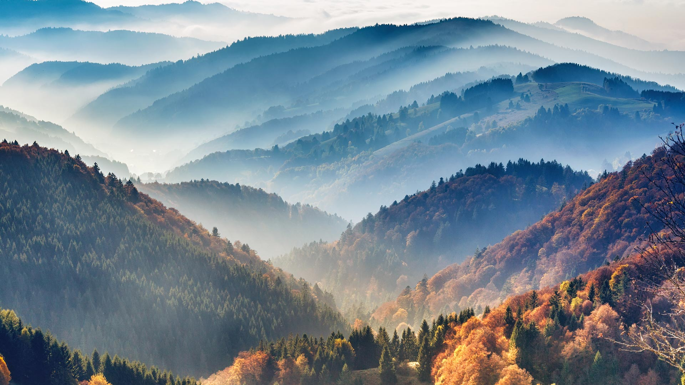
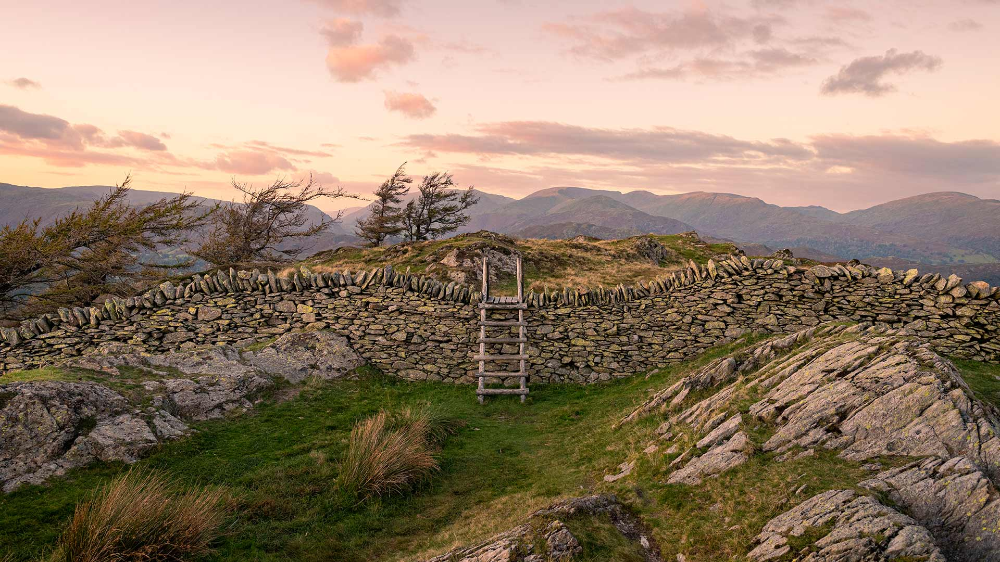

|fullstartdate|name|copyright|title|image|
|--|--|--|--|--|
202610311500|SchwarzwaldAutumn|シュヴァルツヴァルト、バーデン＝ヴュルテンベルク州、ドイツ (© Britus/Getty Images)|木々を包む霧||
202611011500|HudsonBear|ホッキョクグマの親子、ハドソン湾、マニトバ州、カナダ (© Danita Delimont/Adobe Stock)|氷がつなぐ未来||
202611021500|AlpineBraies|ブライエス湖、ファネス・セネス・ブラーイエス自然公園、ドロミテ、イタリア (© leonid_tit/Getty Images)|山々に抱かれた静けさ||
202611031500|AutumnChina|色鮮やかなラクウショウの森をボートで進む人々、安徽省宣城市、中国 (© Jackal Pan/Getty Images)|秋色の森を水上散歩||
202611041500|StileCrossing|石垣に設けられた木製の踏み越し段、ブラック・クラッグ、湖水地方、イギリス (© Alex Treadway/Getty Images)|山頂へ、もう一歩||
202611051500|PipiwaiTrail|ピピワイ・トレイルの竹林、ハレアカラ国立公園、マウイ島、ハワイ、アメリカ (© MNStudio/Getty Images)|マウイ島を抜ける緑のトンネル||
202611061500|DakotaBison|セオドア・ルーズベルト国立公園の草原にいるバイソン、ノースダコタ州、アメリカ (© Tandem Stock/Adobe Stock)|よみがえった草原の巨人||
202611071500|DiwaliLamps|ディーワーリーを彩るランタン、ムンバイ、マハーラーシュトラ州、インド (© Dinodia Photo/Getty Images)|光に包まれる祝祭||
