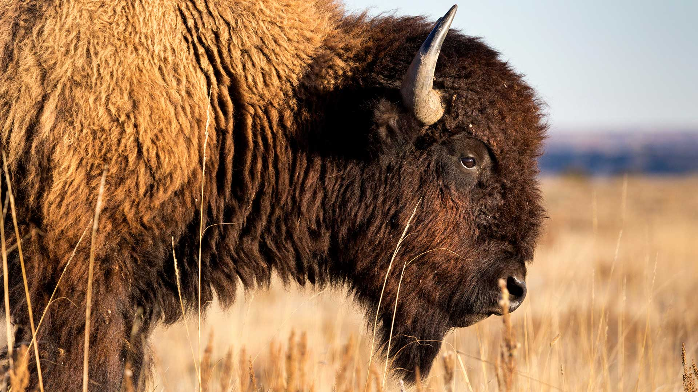
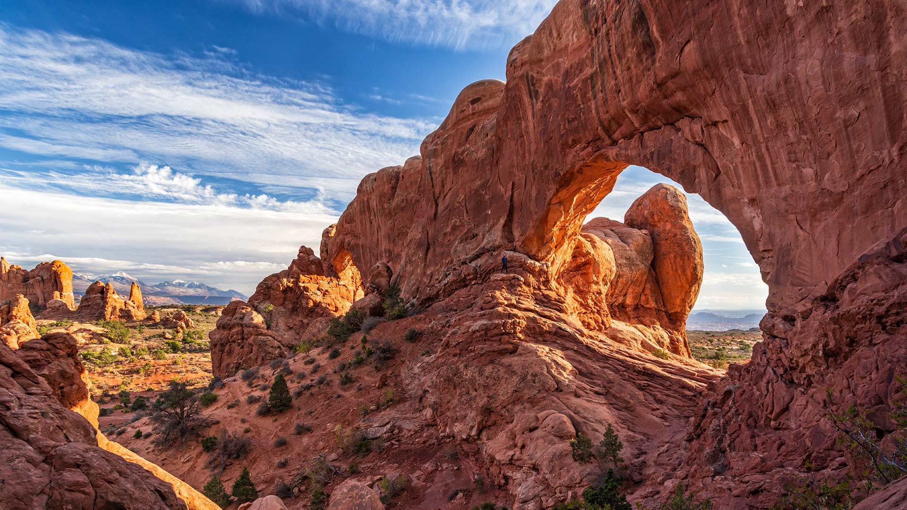
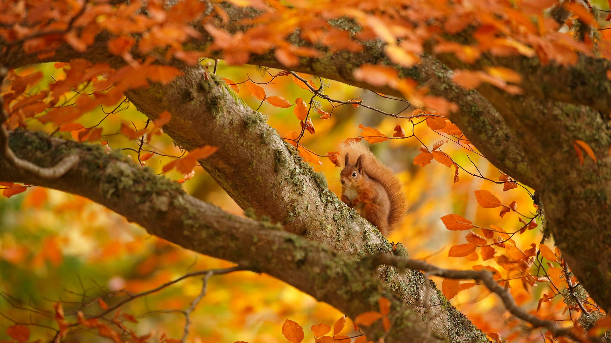
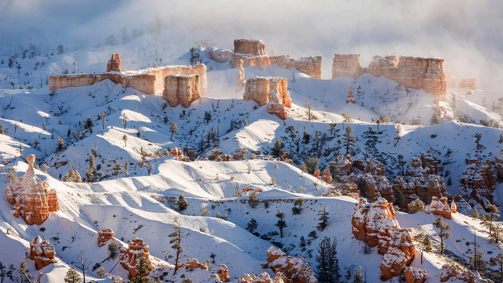
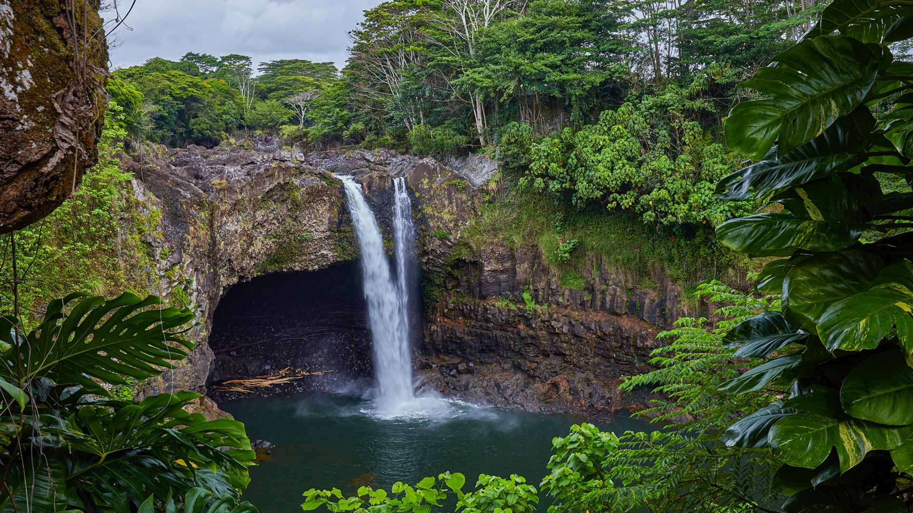
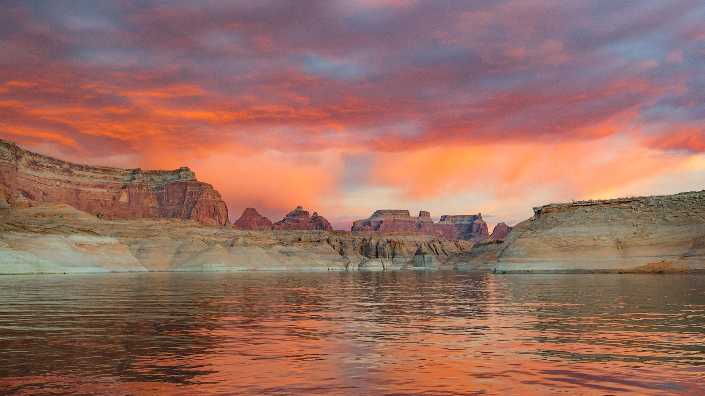

|fullstartdate|name|copyright|title|image|
|--|--|--|--|--|
202610311600|SchwarzwaldAutumn|黑森林，巴登-符腾堡州，德国 (© Britus/Getty Images)|林间迷雾||
202611011600|HudsonBear|北极熊和幼崽，哈得孙湾畔，马尼托巴省，加拿大 (© Danita Delimont/Adobe Stock)|写在冰上的未来||
202611021600|AlpineBraies|布莱埃斯湖，法内斯-塞内斯-布莱埃斯湖自然公园，多洛米蒂山脉，意大利 (© leonid_tit/Getty Images)|群峰间的宁静||
202611031600|AutumnChina|五彩落羽杉间划船的人们，宣城，安徽省，中国 (© Jackal Pan/Getty Images)|泛舟如画秋林||
202611041600|StileCrossing|石墙边的木制翻越梯，黑岩，湖区，英格兰 (© Alex Treadway/Getty Images)|向山巅再迈一步||
202611051600|PipiwaiTrail|竹林，皮皮维小径，哈莱亚卡拉国家公园，毛伊岛，夏威夷州，美国 (© MNStudio/Getty Images)|穿越毛伊岛的绿色隧道||
202611061600|DakotaBison|草原上的一头野牛，西奥多·罗斯福国家公园，北达科他州，美国 (© Tandem Stock/Adobe Stock)|归来的草原巨兽||
202611071600|DiwaliLamps|排灯节灯笼，孟买，马哈拉施特拉邦，印度 (© Dinodia Photo/Getty Images)|光芒四射的节日||
202611081600|TrianaSpain|特里亚纳历史街区，塞维利亚，西班牙 (© Andrzej Rostek/Getty Images)|艺术与韵律交汇之地||
202611091600|RoseIsland|玫瑰岛航拍图，巴哈马 (© Abstract Aerial Art/Getty Images)|惬意放松，尽享海岛时光||
202611101600|Atlantica|大西洋森林，巴西 (© FG Trade/Getty Images)|奇妙纷呈的森林||
202611111600|NorthWindow|北窗，拱门国家公园，莫阿布，犹他州，美国 (© lightphoto/Getty Images)|没有建筑师的建筑杰作||
202611121600|AbrahamCanada|亚伯拉罕湖，艾伯塔省，加拿大 (© Guang Cao/Getty Images)|冰下秘境||
202611131600|BlueHK|中国香港维多利亚港 (© Juan Romero/Cavan Images)|唯有向上发展||
202611141600|FirstFrost|覆霜的红叶杜鹃 (© avoferten/Shutterstock)|霜染枝叶||
202611151600|GilaCliff|美国新墨西哥州吉拉悬崖民居国家纪念地 (© Chiara Salvadori/Getty Images)|历经岁月，屹立不倒||
202611161600|TrailCedars|雪松林步道，冰川国家公园，蒙大拿州，美国 (© DBushue Photography/Getty Images)|走进广阔的大自然||
202611171600|BarnOwlsUnite|一对仓鸮 (© Zahoor Salmi/Getty Images)|从黄昏狩猎到黎明||
202611181600|KnowledgeSculpture|雕塑《知识之躯》，由豪梅·普兰萨创作，位于德国法兰克福的法兰克福歌德大学 (© Todamo/Shutterstock)|思想在此成形||
202611191600|Megaptera|正在潜水的座头鲸，挪威北部特罗姆斯的克瓦尔岛 (© Espen Bergersen/Minden Pictures)|在峡湾中大快朵颐||
202611201600|RedNice|法国普罗旺斯-阿尔卑斯-蔚蓝海岸大区尼斯 (© Siripong Kaewla-iad/Getty Images)|陶瓦屋顶下的梦||
202611211600|JustaHermitage|西班牙坎塔布里亚自治区的圣胡斯塔隐修院与小教堂 (© Tramont_ana/Getty Images)|海浪间的庇护所||
202611221600|FibonacciFern|蕨类植物的卷曲嫩叶 (© Reza Saputra/Getty Images)|自然中的几何之美||
202611231600|CairngormsSquirrel|红松鼠，凯恩戈姆斯国家公园，苏格兰高地 (© Scotland: The Big Picture/Minden Pictures)|秋日的保护色||
202611241600|SunsetPoint|日落观景点，布莱斯峡谷国家公园，犹他州 (© Colin D. Young/Alamy)|美国西南部的一场雪||
202611251600|RFHilo|怀卢库河上的彩虹瀑布，希洛市，夏威夷州，美国 (© Peter Unger/Getty Images)|彩虹落下的地方||
202611261600|FaceCanyon|夕阳下的孤峰，鲍威尔湖脸峡谷，犹他州，美国 (© Jeff Foott/Minden)|灰金交织的峡谷||
